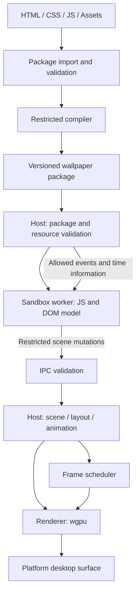

# Sahne — Project Architecture

## 1. Purpose and scope

Build a Rust-based engine that lets users create animated desktop wallpapers with a restricted subset of HTML, CSS, and JavaScript.

Platform priorities are **Windows first, followed by stable Linux support on selected mainstream distributions and desktop environments**. Android is deferred until the desktop milestones are complete. macOS remains a possible future target. Neither Android nor macOS blocks the initial desktop release.

Linux support is defined by tested distribution, release, desktop environment, display server/compositor, and graphics backend combinations. Supporting every distribution or compositor is outside the initial scope. See [Linux support plan](linux-support.md) for the initial candidate matrix and release criteria. Candidates are implementation targets, not verified support claims.

This project is not a browser. It does not aim to run arbitrary websites, React applications, or Three.js content unchanged. The supported web subset is a versioned contract.

HTML/CSS is converted into a validated scene description. JavaScript is not translated into Rust; it runs in a separate restricted process. Performance targets require comparative measurements; Rust alone does not guarantee better performance.

See [Feasibility research](feasibility-research.md) for sources, unresolved assumptions, and technical validation gates. M0 now includes a dependency-free CLI workspace and local Windows build checks. Rendering, sandbox, Linux, and hosted CI/release validation have not been completed.

See [Development roadmap](roadmap.md) for task sequencing, milestone dependencies, completion evidence, and release readiness.

## 2. Core decisions

| Area | Decision | Rationale |
| --- | --- | --- |
| Main language | Rust | Shared infrastructure for core and platform layers |
| Rendering | Narrow custom renderer built on wgpu | Control over GPU resources and frame scheduling |
| Content model | Restricted HTML/CSS and a custom DOM API | Explicit, manageable scope |
| JavaScript | rquickjs candidate; record the bundled QuickJS-family implementation and revision | Restricted host APIs and traceable engine updates |
| Compiler output | Versioned scene data, assets, and JavaScript source | Preprocessing without generating native Rust code |
| Isolation | Separate worker inside an OS sandbox | Security boundary beyond JavaScript runtime isolation |
| GPU access | Managed by the host | No direct native GPU API exposed to the worker |
| Scheduling | Driven by changes and deadlines | Reduce unnecessary frames and CPU wakeups |
| Platform rollout | Windows, then selected Linux configurations | Prove desktop reliability before mobile expansion |

Libraries are implementation candidates. Published versions, licenses, maintenance, target builds, and integration must be verified before adoption. Pin the engine revision, enabled features, toolchain, and dependency lockfile. The current rquickjs source tree uses QuickJS-NG; do not assume a published crate embeds the same revision as its main branch.

## 3. System overview



The host treats compiler and worker output as untrusted. It independently validates package data and every IPC message within its own limits.

## 4. Components and responsibilities

### 4.1 Package compiler

- Parse the manifest, HTML, and CSS files.
- Report unsupported features with file and source-location information.
- Generate static styles and the initial scene.
- Resolve asset references and reject paths outside the package.
- Include format version, API version, and content hashes in the output.

The compiler does not replace the security boundary. Imported compiled packages are validated again. Untrusted parsing, image decoding, and font processing should run in restricted helper processes with explicit budgets. Source-location reporting and HTML error recovery must be validated in a parser spike.

### 4.2 Core

- Scene tree with stable identities and validated property types.
- Style precedence, inheritance, and supported selectors.
- Layout, change tracking, and animation state.
- Resource definitions and lifecycle.
- Data models independent of the platform and JavaScript engine.

The worker owns the script-visible DOM model. The host owns the authoritative rendering scene, containing accepted changes only. Shared identities and ordered transaction batches connect the models. The first API excludes synchronous layout and computed-style reads across this boundary.

### 4.3 Sandboxed worker

- Run the selected JavaScript engine and expose element lookup, text/style updates, events, and timers.
- Expose no filesystem, process-launch, network, or native-module APIs.
- Apply execution budgets and runtime memory limits.
- Bound callbacks, timers, Promise/microtask work, and pending messages.
- Send DOM mutations to the host in batches.

Use engine interrupts for cooperative execution limits and an independent host watchdog to terminate an unresponsive worker, including native-code stalls. Host callbacks must also perform bounded work. Memory policy covers process memory and native allocations as well as the JavaScript heap. Worker restart attempts are limited.

### 4.4 Host

- Start, monitor, and terminate workers.
- Manage package selection, permissions, resources, and user settings.
- Validate IPC schemas, sizes, ownership, and state transitions.
- Coordinate scene state, layout, native animation, and rendering.
- Respond to display, DPI, suspend/resume, and desktop changes.
- Preserve the last valid scene or display a safe fallback after worker failure.

### 4.5 Renderer

- Draw geometry, text, images, and gradients within the supported contract.
- Manage texture atlases, batching, and GPU caches.
- Run transform and opacity animation without script calls where possible.
- Recover from device loss and recreate surfaces.

Initially, any change may redraw the entire surface. Unchanged frames are not rendered. Add partial redraw only after measurements show a real GPU benefit. Group opacity, clipping, alpha compositing, transform order, and stacking behavior must be specified; applying opacity independently to children does not implement group opacity.

### 4.6 Platform adapters

The common interface covers attachment, detachment, surface size/DPI changes, monitor lifecycle, and visibility signals.

The Windows adapter manages a window behind desktop icons. WorkerW can depend on undocumented Explorer behavior and stays in an isolated module. Support reattachment after Explorer restarts and a normal-window development mode. Surface lifetimes must follow the underlying native window lifetime.

Linux uses separate X11 and Wayland integration paths where required. Distribution names alone do not define wallpaper compatibility: GNOME, KDE Plasma, Cinnamon, and their display-server sessions must be evaluated separately. Layer-shell support must be detected rather than assumed. Desktop-specific integrations are allowed behind the common adapter interface. Prioritize the candidate configurations in [Linux support plan](linux-support.md); publish support only after their validation gates pass.

Android is a deferred adapter and application-lifecycle project. A future implementation would use WallpaperService/Engine, a native rendering bridge, and Android-specific worker isolation. Desktop process-launch and window-management code must not be assumed portable to Android.

## 5. Proposed repository structure

```text
Sahne/
├── Cargo.toml
├── crates/
│   ├── wallpaper-core/       # Scene, styles, layout, animation
│   ├── wallpaper-format/     # Manifest, package schema, versioning
│   ├── wallpaper-compiler/   # HTML/CSS validation and scene generation
│   ├── wallpaper-protocol/   # IPC messages, limits, validation
│   ├── wallpaper-runtime/    # JS engine and restricted DOM API
│   ├── wallpaper-renderer/   # wgpu, text, images
│   ├── wallpaper-platform/   # Windows and selected Linux integrations
│   └── wallpaper-sandbox/    # Process launch and OS policies
├── apps/
│   ├── wallpaper-host/
│   ├── wallpaper-worker/
│   └── wallpaper-cli/        # Package validation and development tools
├── examples/
│   ├── static-scene/
│   ├── clock/
│   └── animated-shapes/
├── docs/
│   ├── architecture.md
│   ├── feasibility-research.md
│   ├── linux-support.md
│   ├── supported-features.md # Planned
│   ├── scripting-api.md      # Planned
│   ├── package-format.md     # Planned
│   └── threat-model.md       # Planned
└── benchmarks/
```

This shows intended responsibility boundaries. The first prototype may use fewer crates and separate responsibilities through modules.

## 6. Supported content contract

| Feature | First prototype | First product release target |
| --- | --- | --- |
| Elements | div, span, img | Same restricted element set |
| Layout | Absolute positioning, fixed dimensions | Percentage dimensions and a Flexbox subset |
| Styles | Color, background, text size | Gradients, limited borders and corner rounding |
| Selectors | ID and class | Simple type selectors and explicit inheritance |
| Animation | Opacity, translate, scale | CSS keyframes for supported properties |
| JavaScript | Element lookup, text/style changes, timers | Restricted events and a requestAnimationFrame-like API |
| Media | Static images | Additional budgeted formats evaluated separately |
| Network / filesystem APIs | None | None by default |
| Canvas / WebGL / SVG / Grid | None | Separate scope decision |
| Custom shaders | None | Separate security and cost evaluation |

Unsupported features produce clear errors instead of being silently ignored. Document cascade, units, font fallback, animation behavior, and the meaning of span/text boxes. Browser-identical behavior is not promised.

Before implementation, define document wrappers and style/script loading, UTF-8, allowed attributes, unique IDs, external URL rejection, box sizing, whitespace, wrapping, shorthand rules, and animation-versus-script precedence. Keep mixed inline text flow outside the prototype unless explicitly included in the contract.

## 7. Package format

Example source package:

```text
example-wallpaper/
├── manifest.json
├── index.html
├── style.css
├── script.js
└── assets/
    └── background.png
```

Draft manifest fields:

```json
{
  "formatVersion": 1,
  "apiVersion": 1,
  "id": "example.clock",
  "name": "Minimal Clock",
  "entry": "index.html",
  "script": "script.js",
  "permissions": [],
  "preferredFps": 30
}
```

Compiled output contains the manifest, initial scene, style/animation data, JavaScript source, and an asset index. Version 1 accepts JavaScript source only and rejects externally supplied engine bytecode.

Package import checks path traversal, absolute paths, symbolic links/reparse points, file-count limits, total expanded size, and decompression bombs. Include Windows drive-relative paths, UNC paths, alternate streams, and case collisions in path validation. Avoid reopening validated resources by mutable path names. Limit decoded image dimensions and total decoded memory as well as file size. Content hashes provide integrity and caching, not proof of a trusted publisher.

## 8. Draft scripting API

```js
const clock = document.getElementById("clock");

function updateClock() {
  clock.textContent = wallpaper.time.format("HH:mm");
}

updateClock();
setInterval(updateClock, 1000);

wallpaper.on("pause", () => {});
wallpaper.on("resume", () => updateClock());
```

The application supplies document, timers, and wallpaper. Browser APIs are not automatically available. Specify time-zone and locale behavior for formatting. Animation uses monotonic time; calendar time is separate.

This introductory example polls once per second. A production minute-only clock should schedule its next update at the next minute boundary to avoid unnecessary script wakeups.

Synchronous getBoundingClientRect, offsetWidth, and computed-style reads are outside the initial API. A future asynchronous, revision-tagged layout snapshot may be considered.

Audio analysis and network access are outside the first release. Future capabilities require an explicit permission model and data minimization.

## 9. IPC and consistency

- Use typed, length-bounded messages; do not deserialize arbitrary objects.
- Include protocol version, session ID, sequence number, and base scene revision.
- Allow restricted operations such as SetText and SetStyle, never native addresses, filesystem paths, or GPU commands.
- Validate node ownership, identity generation, property types, numeric ranges, and finite numbers.
- Validate an entire transaction before applying it atomically; no partial acceptance.
- Bound all queues, including acknowledgements and errors. Apply backpressure and coalesce updates only when operation ordering remains correct.
- Keep a bounded number of ordered pending batches. Commit accepted state after the host acknowledgement. Initially, a rejected batch closes the session cleanly instead of attempting complex rollback.
- Define a temporary worker-local view so scripts can read their own writes within a callback without claiming host acceptance.
- Refer to resources through host-issued IDs.

Enforce limits before decoding, during allocation/collection decoding, and after semantic validation. Logs and diagnostic messages also have budgets.

## 10. Sandbox and threat model

Untrusted inputs include source packages, compiled scenes, JavaScript, images, fonts, and worker messages. The OS, host, and graphics driver are part of the trusted computing base; minimize exposed attack surfaces.

On Windows, evaluate AppContainer/LPAC, Job Objects, and restricted handle transfer together. Grant no network capability and expose only required IPC resources. Job Objects alone are not a security sandbox. Validate process launch, file permissions, and IPC ACLs in the actual restricted process.

Exposing no filesystem API to scripts does not imply the OS process can read no files. Document required executable/library/system-resource access and test unauthorized access through direct OS calls inside a trusted sandbox test harness.

On Linux, combine namespaces, seccomp, and Landlock where available with resource limits. Availability depends on distribution and kernel policy. Establish a tested sandbox profile for every supported configuration. If mandatory isolation is unavailable, untrusted content must not silently run with weaker protection.

Initially, use one worker per wallpaper session. A worker failure must not terminate the host or other sessions. Sharing workers across monitors may be evaluated later while preserving isolation and resource ownership.

Resource limits are host policy and cannot be increased by packages. Cover process memory, JavaScript execution time, timers/callbacks/microtasks, scene nodes, text length, IPC size/rate, texture dimensions, decoded assets, and FPS. Determine final values through benchmarks.

## 11. Frame scheduling and performance

The scheduler computes the next required wakeup from scene changes, active animation, script callback deadlines, and platform events.

| State | Behavior |
| --- | --- |
| Static scene | Render once, then wait for a change or surface event |
| Minute clock | Render only when displayed text changes |
| CSS animation | Advance native animation at the configured FPS limit |
| Script animation | Budget callbacks and batch scene mutations |
| Fullscreen application | Pause according to policy and available visibility signals |
| Display off / session locked | Pause scripting and rendering |
| Resume | Apply explicitly defined animation and timer semantics |

Do not replay an unlimited backlog of missed timers. Bound catch-up steps for fixed-timestep simulations. Visibility detection may be imperfect; let users change pause policy. Distinguish no redraws from no CPU wakeups.

Benchmark static images, a digital clock, transform/opacity animation, and a dense moving scene against a WebView reference at the same resolution, FPS, visual quality, and hardware. Measure all host/worker/helper processes together: RAM, CPU, GPU time, frame-time distributions, idle wakeups, and startup. Publish measured results rather than assuming an advantage.

## 12. Implementation candidates

| Task | Candidate | Boundary |
| --- | --- | --- |
| HTML parsing | html5ever | DOM and product semantics remain custom |
| CSS parsing | cssparser initially; Lightning CSS as an alternative | Neither supplies the full style/layout/painting system |
| Layout | Taffy | Style mapping and drawing remain custom |
| JavaScript | rquickjs with a pinned bundled engine revision | Requires OS sandbox and resource policy |
| GPU | wgpu | Requires a 2D layer and scene renderer |
| Text | cosmic-text and compatible glyphon | Font resources and atlas budgets remain application responsibilities |
| Data models | serde | Requires schema validation and size limits |

Research identified wgpu 30.0.1, glyphon 0.12.0, and cosmic-text 0.19.0 as a dependency-compatible candidate set. This is not a completed build validation. See the research report for the version and license snapshot.

## 13. Development phases and acceptance criteria

### Phase 0 — Contract and security design

Write the supported HTML/CSS list, scripting API, package/protocol schemas, and threat model. Run a small Windows sandbox/IPC spike. Record the Linux candidate matrix and integration risks early, especially GNOME and Plasma paths.

**Acceptance:** Feature boundaries and validation gates are explicit; direct OS access and process isolation tests are defined. Linux candidates are distinguished from verified configurations.

### Phase 1 — Windows rendering prototype

Draw shapes, text, and images in a normal development window and behind desktop icons. Handle size/DPI changes and Explorer restarts.

**Acceptance:** Static scenes have no continuous render loop; window lifecycle changes do not crash the application. Pass research gate G1.

### Phase 2 — Restricted HTML/CSS and animation

Compile HTML/CSS into the initial scene. Add absolute positioning, basic styles, and transform/opacity keyframes.

**Acceptance:** Unsupported features produce useful errors; example scenes match their expected appearance. Pass research gate G3.

### Phase 3 — Sandbox worker and JavaScript

Integrate the selected engine, restricted DOM, timers, microtask budgets, IPC, and resource limits. Enable untrusted content only after sandbox validation.

**Acceptance:** Infinite loops, memory exhaustion, IPC floods, native stalls, and worker crashes do not take down the host. Unauthorized file/network access is blocked. Pass research gate G2.

### Phase 4 — Desktop product foundations

Add package import, error screens, settings, multiple monitors, caches, and pause policies. Optimize using measurements.

**Acceptance:** Malformed packages are rejected safely; long runs do not show unbounded memory/GPU resource growth. Record reproducible reference comparisons and pass research gate G5 before making performance claims.

### Phase 5 — Stable Linux support on selected configurations

Implement platform and sandbox adapters for the candidate distribution/desktop/session matrix. Prioritize default desktop sessions on Ubuntu LTS, Fedora Workstation, Linux Mint Cinnamon, Debian stable, and Kubuntu LTS. This is a practical initial selection, not a measured popularity ranking. Confirm exact release/session versions during Linux planning.

GNOME integration is an explicit work item. Passing a layer-shell test on another compositor does not satisfy the Ubuntu/Fedora GNOME targets. A gap remains visible until implemented and validated; support may be released per configuration.

**Acceptance:** Pass gate G6 and the stability checklist in [Linux support plan](linux-support.md). Publish the exact tested matrix and known limitations. Keep core and package semantics shared across platforms.

### Phase 6 — Deferred mobile evaluation

After the Windows and selected Linux milestones, revisit Android service lifecycle, native surfaces, isolation, and device/energy testing. Its future gate G4 does not block desktop development or releases. macOS requires a separate future scope decision.

## 14. Validation approach

- Malformed-input and fuzz testing at parser, archive, and IPC boundaries.
- Behavioral tests for style precedence, layout, and animation timing.
- Visual comparisons for text, images, and animations.
- Real sandbox tests for files, network, handle/descriptor transfer, and resource exhaustion.
- Explorer restart, monitor hotplug, DPI changes, lock, and suspend/resume tests.
- Linux desktop/session lifecycle, package installation, kernel sandbox support, and display-backend testing on the declared matrix.
- Repeatable benchmarks and long-duration resource monitoring.

## 15. Open decisions and risks

1. **Feature scope:** Flexbox, wrapping, and font behavior substantially affect workload.
2. **Rendering:** Measure the narrow custom 2D layer before committing to a broader rendering library.
3. **Windows integration:** Explorer behavior needs version-specific regression coverage.
4. **Linux integration:** Mainstream distribution coverage requires desktop/compositor-specific work and an explicit tested matrix.
5. **Sandbox:** OS isolation, engine updates, and native parsers require continuing maintenance.
6. **Compatibility expectations:** Web syntax can imply browser compatibility; expose the supported contract in tooling.
7. **Performance:** Lower RAM/CPU remains a hypothesis until measured on equivalent workloads.
8. **Deferred platforms:** Android and macOS have no initial delivery commitment.

The first milestone remains a small Windows end-to-end prototype: idle when static, animate supported properties, and run a clock script inside a validated sandbox. The next platform milestone is stable support for the selected Linux configurations.

## 16. M0 implementation snapshot

The initial workspace contains only apps/wallpaper-cli; other crates remain planned. Rust 1.99.1 is pinned, with no external Rust dependencies. The CLI exposes help/version only. CI checks Windows builds; release pushes are configured to publish development prereleases, not stable product builds. See [Development guide](development.md), [Dependency review](dependency-review.md), [Content contract](supported-features.md), [Scripting contract](scripting-api.md), [Package and IPC contract](package-format.md), and [Threat model](threat-model.md). Contracts remain drafts for the technical spikes.
