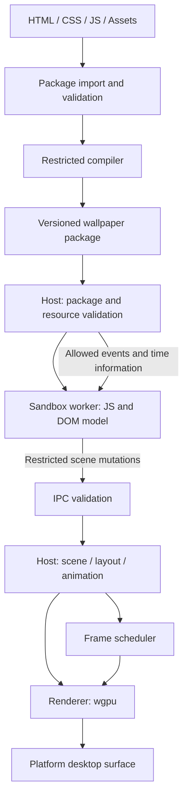

# Sahne — Project Architecture

## 1. Purpose and scope

Build a Rust-based engine that lets users create animated desktop wallpapers with a restricted subset of HTML, CSS, and JavaScript.

Platform priorities are **Windows first, followed by stable Linux support on selected mainstream distributions and desktop environments**. Android is deferred until the desktop milestones are complete. macOS remains a possible future target. Neither Android nor macOS blocks the initial desktop release.

Linux support is defined by tested distribution, release, desktop environment, display server/compositor, and graphics backend combinations. Supporting every distribution or compositor is outside the initial scope. See [Linux support plan](linux-support.md) for the initial candidate matrix and release criteria. Candidates are implementation targets, not verified support claims.

This project is not a browser. It does not aim to run arbitrary websites, React applications, or Three.js content unchanged. The supported web subset is a versioned contract.

HTML/CSS is converted into a validated scene description. JavaScript is not translated into Rust; it runs in a separate restricted process. Performance targets require comparative measurements; Rust alone does not guarantee better performance.

See [Feasibility research](feasibility-research.md) for sources, unresolved assumptions and technical validation gates. M0's hosted CI/development release and M1's targeted Windows rendering/lifecycle checks have recorded evidence. M2's fixed trusted sandbox/IPC spike is complete; [its acceptance record](m2-acceptance.md) distinguishes initial G2 evidence from the still-open production gate. Arbitrary content, complete platform matrices, content integration and Linux validation remain pending.

See [Development roadmap](roadmap.md) for task sequencing, milestone dependencies, completion evidence, and release readiness.

## 2. Core decisions

| Area | Decision | Rationale |
| --- | --- | --- |
| Main language | Rust | Shared infrastructure for core and platform layers |
| Rendering | Narrow custom renderer built on wgpu | Control over GPU resources and frame scheduling |
| Content model | Restricted HTML/CSS and a custom DOM API | Explicit, manageable scope |
| JavaScript | rquickjs 0.14.0 in trusted M2 Windows fixtures; QuickJS-NG snapshot pinned in the dependency review | Product APIs/untrusted content remain pending; traceable engine updates |
| Compiler output | Versioned scene data, assets, and JavaScript source | Preprocessing without generating native Rust code |
| Isolation | Separate worker inside an OS sandbox | Security boundary beyond JavaScript runtime isolation |
| GPU access | Managed by the host | No direct native GPU API exposed to the worker |
| Scheduling | Driven by changes and deadlines | Reduce unnecessary frames and CPU wakeups |
| Platform rollout | Windows, then selected Linux configurations | Prove desktop reliability before mobile expansion |

Libraries are implementation candidates. Published versions, licenses, maintenance, target builds, and integration must be verified before adoption. Pin the engine revision, enabled features, toolchain, and dependency lockfile. The current rquickjs source tree uses QuickJS-NG; do not assume a published crate embeds the same revision as its main branch.

## 3. System overview



The host treats compiler and worker output as untrusted. It independently validates package data and every IPC message within its own limits.

## 4. Components and responsibilities

### 4.1 Package compiler

- Parse the manifest, HTML, and CSS files.
- Report unsupported features with file and source-location information.
- Generate static styles and the initial scene.
- Resolve asset references and reject paths outside the package.
- Include format version, API version, and content hashes in the output.

The compiler does not replace the security boundary. Imported compiled packages are validated again. Untrusted parsing, image decoding, and font processing should run in restricted helper processes with explicit budgets. Source-location reporting and HTML error recovery must be validated in a parser spike.

### 4.2 Core

- Scene tree with stable identities and validated property types.
- Style precedence, inheritance, and supported selectors.
- Layout, change tracking, and animation state.
- Resource definitions and lifecycle.
- Data models independent of the platform and JavaScript engine.

The worker owns the script-visible DOM model. The host owns the authoritative rendering scene, containing accepted changes only. Shared identities and ordered transaction batches connect the models. The first API excludes synchronous layout and computed-style reads across this boundary.

### 4.3 Sandboxed worker

- Run the selected JavaScript engine and expose element lookup, text/style updates, events, and timers.
- Expose no filesystem, process-launch, network, or native-module APIs.
- Apply execution budgets and runtime memory limits.
- Bound callbacks, timers, Promise/microtask work, and pending messages.
- Send DOM mutations to the host in batches.

Use engine interrupts for cooperative execution limits and an independent host watchdog to terminate an unresponsive worker, including native-code stalls. Host callbacks must also perform bounded work. Memory policy covers process memory and native allocations as well as the JavaScript heap. Worker restart attempts are limited.

### 4.4 Host

- Start, monitor, and terminate workers.
- Manage package selection, permissions, resources, and user settings.
- Validate IPC schemas, sizes, ownership, and state transitions.
- Coordinate scene state, layout, native animation, and rendering.
- Respond to display, DPI, suspend/resume, and desktop changes.
- Preserve the last valid scene or display a safe fallback after worker failure.

### 4.5 Renderer

- Draw geometry, text, images, and gradients within the supported contract.
- Manage texture atlases, batching, and GPU caches.
- Run transform and opacity animation without script calls where possible.
- Recover from device loss and recreate surfaces.

Initially, any change may redraw the entire surface. Unchanged frames are not rendered. Add partial redraw only after measurements show a real GPU benefit. Group opacity, clipping, alpha compositing, transform order, and stacking behavior must be specified; applying opacity independently to children does not implement group opacity.

### 4.6 Platform adapters

The common interface covers attachment, detachment, surface size/DPI changes, monitor lifecycle, and visibility signals.

The Windows adapter manages a window behind desktop icons. WorkerW can depend on undocumented Explorer behavior and stays in an isolated module. Support reattachment after Explorer restarts and a normal-window development mode. Surface lifetimes must follow the underlying native window lifetime.

Linux uses separate X11 and Wayland integration paths where required. Distribution names alone do not define wallpaper compatibility: GNOME, KDE Plasma, Cinnamon, and their display-server sessions must be evaluated separately. Layer-shell support must be detected rather than assumed. Desktop-specific integrations are allowed behind the common adapter interface. Prioritize the candidate configurations in [Linux support plan](linux-support.md); publish support only after their validation gates pass.

Android is a deferred adapter and application-lifecycle project. A future implementation would use WallpaperService/Engine, a native rendering bridge, and Android-specific worker isolation. Desktop process-launch and window-management code must not be assumed portable to Android.

## 5. Proposed repository structure

```text
Sahne/
├── Cargo.toml
├── crates/
│   ├── wallpaper-core/       # Scene, styles, layout, animation
│   ├── wallpaper-format/     # Manifest, package schema, versioning
│   ├── wallpaper-compiler/   # HTML/CSS validation and scene generation
│   ├── wallpaper-protocol/   # IPC messages, limits, validation
│   ├── wallpaper-runtime/    # JS engine and restricted DOM API
│   ├── wallpaper-renderer/   # wgpu, text, images
│   ├── wallpaper-platform/   # Windows and selected Linux integrations
│   └── wallpaper-sandbox/    # Process launch and OS policies
├── apps/
│   ├── wallpaper-host/
│   ├── wallpaper-worker/
│   └── wallpaper-cli/        # Package validation and development tools
├── examples/
│   ├── static-scene/
│   ├── clock/
│   └── animated-shapes/
├── docs/
│   ├── architecture.md
│   ├── feasibility-research.md
│   ├── linux-support.md
│   ├── supported-features.md # Planned
│   ├── scripting-api.md      # Planned
│   ├── package-format.md     # Planned
│   └── threat-model.md       # Planned
└── benchmarks/
```

This shows intended responsibility boundaries. The first prototype may use fewer crates and separate responsibilities through modules.

## 6. Supported content contract

| Feature | First prototype | First product release target |
| --- | --- | --- |
| Elements | div, span, img | Same restricted element set |
| Layout | Absolute positioning, fixed dimensions | Percentage dimensions and a Flexbox subset |
| Styles | Color, background, text size | Gradients, limited borders and corner rounding |
| Selectors | ID and class | Simple type selectors and explicit inheritance |
| Animation | Opacity, translate, scale | CSS keyframes for supported properties |
| JavaScript | Element lookup, text/style changes, timers | Restricted events and a requestAnimationFrame-like API |
| Media | Static images | Additional budgeted formats evaluated separately |
| Network / filesystem APIs | None | None by default |
| Canvas / WebGL / SVG / Grid | None | Separate scope decision |
| Custom shaders | None | Separate security and cost evaluation |

Unsupported features produce clear errors instead of being silently ignored. Document cascade, units, font fallback, animation behavior, and the meaning of span/text boxes. Browser-identical behavior is not promised.

Before implementation, define document wrappers and style/script loading, UTF-8, allowed attributes, unique IDs, external URL rejection, box sizing, whitespace, wrapping, shorthand rules, and animation-versus-script precedence. Keep mixed inline text flow outside the prototype unless explicitly included in the contract.

## 7. Package format

Example source package:

```text
example-wallpaper/
├── manifest.json
├── index.html
├── style.css
├── script.js
└── assets/
    └── background.png
```

Draft manifest fields:

```json
{
  "formatVersion": 1,
  "apiVersion": 1,
  "id": "example.clock",
  "name": "Minimal Clock",
  "entry": "index.html",
  "script": "script.js",
  "permissions": [],
  "preferredFps": 30
}
```

Compiled output contains the manifest, initial scene, style/animation data, JavaScript source, and an asset index. Version 1 accepts JavaScript source only and rejects externally supplied engine bytecode.

Package import checks path traversal, absolute paths, symbolic links/reparse points, file-count limits, total expanded size, and decompression bombs. Include Windows drive-relative paths, UNC paths, alternate streams, and case collisions in path validation. Avoid reopening validated resources by mutable path names. Limit decoded image dimensions and total decoded memory as well as file size. Content hashes provide integrity and caching, not proof of a trusted publisher.

## 8. Draft scripting API

```js
const clock = document.getElementById("clock");

function updateClock() {
  clock.textContent = wallpaper.time.format("HH:mm");
}

updateClock();
setInterval(updateClock, 1000);

wallpaper.on("pause", () => {});
wallpaper.on("resume", () => updateClock());
```

The application supplies document, timers, and wallpaper. Browser APIs are not automatically available. Specify time-zone and locale behavior for formatting. Animation uses monotonic time; calendar time is separate.

This introductory example polls once per second. A production minute-only clock should schedule its next update at the next minute boundary to avoid unnecessary script wakeups.

Synchronous getBoundingClientRect, offsetWidth, and computed-style reads are outside the initial API. A future asynchronous, revision-tagged layout snapshot may be considered.

Audio analysis and network access are outside the first release. Future capabilities require an explicit permission model and data minimization.

## 9. IPC and consistency

- Use typed, length-bounded messages; do not deserialize arbitrary objects.
- Include protocol version, session ID, sequence number, and base scene revision.
- Allow restricted operations such as SetText and SetStyle, never native addresses, filesystem paths, or GPU commands.
- Validate node ownership, identity generation, property types, numeric ranges, and finite numbers.
- Validate an entire transaction before applying it atomically; no partial acceptance.
- Bound all queues, including acknowledgements and errors. Apply backpressure and coalesce updates only when operation ordering remains correct.
- Keep a bounded number of ordered pending batches. Commit accepted state after the host acknowledgement. Initially, a rejected batch closes the session cleanly instead of attempting complex rollback.
- Define a temporary worker-local view so scripts can read their own writes within a callback without claiming host acceptance.
- Refer to resources through host-issued IDs.

Enforce limits before decoding, during allocation/collection decoding, and after semantic validation. Logs and diagnostic messages also have budgets.

## 10. Sandbox and threat model

Untrusted inputs include source packages, compiled scenes, JavaScript, images, fonts, and worker messages. The OS, host, and graphics driver are part of the trusted computing base; minimize exposed attack surfaces.

On Windows, evaluate AppContainer/LPAC, Job Objects, and restricted handle transfer together. Grant no network capability and expose only required IPC resources. Job Objects alone are not a security sandbox. Validate process launch, file permissions, and IPC ACLs in the actual restricted process.

Exposing no filesystem API to scripts does not imply the OS process can read no files. Document required executable/library/system-resource access and test unauthorized access through direct OS calls inside a trusted sandbox test harness.

On Linux, combine namespaces, seccomp, and Landlock where available with resource limits. Availability depends on distribution and kernel policy. Establish a tested sandbox profile for every supported configuration. If mandatory isolation is unavailable, untrusted content must not silently run with weaker protection.

Initially, use one worker per wallpaper session. A worker failure must not terminate the host or other sessions. Sharing workers across monitors may be evaluated later while preserving isolation and resource ownership.

Resource limits are host policy and cannot be increased by packages. Cover process memory, JavaScript execution time, timers/callbacks/microtasks, scene nodes, text length, IPC size/rate, texture dimensions, decoded assets, and FPS. Determine final values through benchmarks.

## 11. Frame scheduling and performance

The scheduler computes the next required wakeup from scene changes, active animation, script callback deadlines, and platform events.

| State | Behavior |
| --- | --- |
| Static scene | Render once, then wait for a change or surface event |
| Minute clock | Render only when displayed text changes |
| CSS animation | Advance native animation at the configured FPS limit |
| Script animation | Budget callbacks and batch scene mutations |
| Fullscreen application | Pause according to policy and available visibility signals |
| Display off / session locked | Pause scripting and rendering |
| Resume | Apply explicitly defined animation and timer semantics |

Do not replay an unlimited backlog of missed timers. Bound catch-up steps for fixed-timestep simulations. Visibility detection may be imperfect; let users change pause policy. Distinguish no redraws from no CPU wakeups.

Benchmark static images, a digital clock, transform/opacity animation, and a dense moving scene against a WebView reference at the same resolution, FPS, visual quality, and hardware. Measure all host/worker/helper processes together: RAM, CPU, GPU time, frame-time distributions, idle wakeups, and startup. Publish measured results rather than assuming an advantage.

## 12. Implementation candidates

| Task | Candidate | Boundary |
| --- | --- | --- |
| HTML parsing | html5ever | DOM and product semantics remain custom |
| CSS parsing | cssparser initially; Lightning CSS as an alternative | Neither supplies the full style/layout/painting system |
| Layout | Taffy | Style mapping and drawing remain custom |
| JavaScript | rquickjs with a pinned bundled engine revision | Requires OS sandbox and resource policy |
| GPU | wgpu | Requires a 2D layer and scene renderer |
| Text | cosmic-text and compatible glyphon | Font resources and atlas budgets remain application responsibilities |
| Data models | serde | Requires schema validation and size limits |

Research identified wgpu 30.0.1, glyphon 0.12.0, and cosmic-text 0.19.0 as a dependency-compatible candidate set. This is not a completed build validation. See the research report for the version and license snapshot.

## 13. Development phases and acceptance criteria

### Phase 0 — Contract and security design

Write the supported HTML/CSS list, scripting API, package/protocol schemas, and threat model. Run a small Windows sandbox/IPC spike. Record the Linux candidate matrix and integration risks early, especially GNOME and Plasma paths.

**Acceptance:** Feature boundaries and validation gates are explicit; direct OS access and process isolation tests are defined. Linux candidates are distinguished from verified configurations.

### Phase 1 — Windows rendering prototype

Draw shapes, text, and images in a normal development window and behind desktop icons. Handle size/DPI changes and Explorer restarts.

**Acceptance:** Static scenes have no continuous render loop; window lifecycle changes do not crash the application. Pass research gate G1.

### Phase 2 — Restricted HTML/CSS and animation

Compile HTML/CSS into the initial scene. Add absolute positioning, basic styles, and transform/opacity keyframes.

**Acceptance:** Unsupported features produce useful errors; example scenes match their expected appearance. Pass research gate G3.

### Phase 3 — Sandbox worker and JavaScript

Integrate the selected engine, restricted DOM, timers, microtask budgets, IPC, and resource limits. Enable untrusted content only after sandbox validation.

**Acceptance:** Infinite loops, memory exhaustion, IPC floods, native stalls, and worker crashes do not take down the host. Unauthorized file/network access is blocked. Pass research gate G2.

### Phase 4 — Desktop product foundations

Add package import, error screens, settings, multiple monitors, caches, and pause policies. Optimize using measurements.

**Acceptance:** Malformed packages are rejected safely; long runs do not show unbounded memory/GPU resource growth. Record reproducible reference comparisons and pass research gate G5 before making performance claims.

### Phase 5 — Stable Linux support on selected configurations

Implement platform and sandbox adapters for the candidate distribution/desktop/session matrix. Prioritize default desktop sessions on Ubuntu LTS, Fedora Workstation, Linux Mint Cinnamon, Debian stable, and Kubuntu LTS. This is a practical initial selection, not a measured popularity ranking. Confirm exact release/session versions during Linux planning.

GNOME integration is an explicit work item. Passing a layer-shell test on another compositor does not satisfy the Ubuntu/Fedora GNOME targets. A gap remains visible until implemented and validated; support may be released per configuration.

**Acceptance:** Pass gate G6 and the stability checklist in [Linux support plan](linux-support.md). Publish the exact tested matrix and known limitations. Keep core and package semantics shared across platforms.

### Phase 6 — Deferred mobile evaluation

After the Windows and selected Linux milestones, revisit Android service lifecycle, native surfaces, isolation, and device/energy testing. Its future gate G4 does not block desktop development or releases. macOS requires a separate future scope decision.

## 14. Validation approach

- Malformed-input and fuzz testing at parser, archive, and IPC boundaries.
- Behavioral tests for style precedence, layout, and animation timing.
- Visual comparisons for text, images, and animations.
- Real sandbox tests for files, network, handle/descriptor transfer, and resource exhaustion.
- Explorer restart, monitor hotplug, DPI changes, lock, and suspend/resume tests.
- Linux desktop/session lifecycle, package installation, kernel sandbox support, and display-backend testing on the declared matrix.
- Repeatable benchmarks and long-duration resource monitoring.

## 15. Open decisions and risks

1. **Feature scope:** Flexbox, wrapping, and font behavior substantially affect workload.
2. **Rendering:** Measure the narrow custom 2D layer before committing to a broader rendering library.
3. **Windows integration:** Explorer behavior needs version-specific regression coverage.
4. **Linux integration:** Mainstream distribution coverage requires desktop/compositor-specific work and an explicit tested matrix.
5. **Sandbox:** OS isolation, engine updates, and native parsers require continuing maintenance.
6. **Compatibility expectations:** Web syntax can imply browser compatibility; expose the supported contract in tooling.
7. **Performance:** Lower RAM/CPU remains a hypothesis until measured on equivalent workloads.
8. **Deferred platforms:** Android and macOS have no initial delivery commitment.

The first milestone remains a small Windows end-to-end prototype: idle when static, animate supported properties, and run a clock script inside a validated sandbox. The next platform milestone is stable support for the selected Linux configurations.

## 16. M0 implementation snapshot

The initial workspace contains only apps/wallpaper-cli; other crates remain planned. Rust 1.99.1 is pinned, with no external Rust dependencies. The CLI exposes help/version only. CI checks Windows builds; release pushes are configured to publish development prereleases, not stable product builds. See [Development guide](development.md), [Dependency review](dependency-review.md), [Content contract](supported-features.md), [Scripting contract](scripting-api.md), [Package and IPC contract](package-format.md), and [Threat model](threat-model.md). Contracts remain drafts for the technical spikes.

## 17. M1 implementation snapshot

The workspace adds apps/wallpaper-preview and crates/wallpaper-platform. The preview renders only a trusted built-in shape, text and RGBA image with wgpu/D3D12, winit and glyphon. The Windows adapter creates an Explorer WorkerW child window before GPU surface creation and bounds reconnect attempts. Native FFI stays in the platform crate; its narrowly documented unsafe-lint exception does not apply to CLI/preview or future workers. Text now uses a single embedded Noto Sans font and a dedicated font database; no external input is exposed. See [Font provenance](bundled-font.md). Per-monitor layout, full device recovery and G1 lifecycle certification remain pending. See [M1 preview](m1-preview.md) and [Dependency assessment](m1-dependencies.md).

### M1 lifecycle refinement

The preview uses generation-tagged device-loss notifications to rebuild native/GPU state and ignore stale callbacks. Desktop ownership checks include PID and class; periodic size checks update the child surface. Real faults and synthetic teardown share a bounded run-wide recovery budget. No dependency or sandbox policy changed. Ten actual Explorer restart cycles each reached a new presented generation; hardware GPU loss and the remaining display/power matrix are not certified. See [Lifecycle validation](m1-lifecycle-validation.md).

## 18. Planned Wallpaper Engine import boundary

Compatibility planning proceeds alongside native development; importer implementation starts only after M4's compiler and sandboxed scripting path work end to end. The first target is a declared subset of local web-project conversion and explicit compatibility reporting. A separate frontend translates supported metadata/assets into Sahne's validated package format; a narrow API adapter stays within existing worker/host permissions. Core scene, renderer and sandbox behavior remain authoritative.

During M2/M3, specify capability reporting, settings/default/update semantics, host-capped FPS, pause behavior and source provenance. Do not silently supply browser APIs or expand the feature contract to fit a complex example. Canvas/WebGL/audio/network and dynamic filesystem access remain separate scope decisions. Scene PKG/TEX extraction is a later independent track; extraction does not imply scene/SceneScript playback. No browser backend is currently selected.

samples/ contains ignored optional local research inputs, never CI prerequisites or release contents. Static findings and required original synthetic fixtures are documented under docs/. Original samples remain unmodified and unexecuted during inspection. See [Import plan](wallpaper-engine-import-plan.md) and [Sample assessment](wallpaper-engine-samples.md). This is an approved planning boundary, not implemented compatibility support.

### Application-device recovery validation

A dedicated test mode destroys only the preview's own wgpu device. Generation-tagged callbacks plus a later-generation presented frame are required for success. Normal and desktop runs passed on the recorded RTX 3050 configuration. The fixed font is now embedded with its OFL notice and loaded without system discovery. No new Rust dependency or relaxed isolation policy was introduced. Real driver loss, hotplug and changed-DPI behavior remain separate unverified cases.

## 19. M2 control-frame foundation

The workspace now includes crates/wallpaper-protocol as a safe std-only transport-neutral codec for bounded Hello/Ping/Pong/Reject control messages and a test-only ProbeResult. Encoding and complete structural validation are independent from OS channel security and host state acceptance; envelope checks do not mutate scene/sequence state. Scene transactions remain planned M4 work. See [M2 wire contract and tests](m2-protocol.md).

## 20. M2 trusted Windows sandbox experiment

apps/wallpaper-sandbox-probe uses crates/wallpaper-sandbox to stage its own trusted executable in a fresh directory, create a unique standard AppContainer with zero capabilities and transfer only two explicitly listed pipe endpoints. The native crate has the same narrow unsafe-FFI exception as wallpaper-platform; safe application crates retain the unsafe prohibition. The host creates the process suspended, assigns a kill-on-close Job (one active process, 256 MiB process memory), verifies its actual token/profile/capabilities, then resumes it. ACL changes apply only to the fresh executable staging directory and exact profile SID. A curated OS-location environment excludes inherited credentials/proxies/PATH.

One bounded control conversation has independent host deadlines and failure cleanup; no JavaScript, package import, renderer integration or worker restart is enabled. Direct sentinel file and host VM-open denial, native stall termination, oversized-prefix rejection and controlled worker exit have local evidence. Network testing returned a timeout rather than explicit access denial; LPAC, broader OS access, memory/CPU/IPC exhaustion and integrated G2 remain open. This experiment does not establish a production launch policy. See [Sandbox boundary, commands and evidence](m2-sandbox.md).

The next trusted-probe continuation adds independent outbound TEST-NET-1 TCP and Job memory cases. Outbound TCP requires explicit Windows denial, while the original loopback timeout remains inconclusive. The memory helper queries the actual worker Job, verifies a small committed allocation succeeds and one request above the unchanged 256 MiB limit fails, then requires normal IPC and exit. Only the existing windows-sys Memory API binding feature is added; no package, capability or resource limit changes. These are narrow native checks, not full network/exhaustion or JS validation.

Further trusted fixtures query the one-process Job quota and attempt suspended creation of the staged executable, and test exclusion of an intentionally inheritable host sentinel handle from the explicit list. The host keeps that file open and independently queries the worker's strict-handle mitigation before resume. The handle test validates an armed IPC stage before accepting either a returned invalid-handle report or the exact strict-policy fatal exit; ordinary crashes/EOF/timeouts remain failures. Only the intentional-fault worker suppresses its own WER invocation; no mitigation or deadline is disabled. Existing windows-sys SystemServices/Diagnostics_Debug bindings supply these calls without changing external versions. Broader process/handle/endpoint and integrated G2 coverage remain pending.

The one-shot probe conversation now ends only at clean EOF after its final result. The first trailing byte is a typed rejection; the host does not drain or queue unsolicited frames. The independent deadline also covers incomplete frame bodies and a peer retaining an open stream after a valid report. New restricted-worker fixtures cover unsolicited-message flood, partial-body stall/EOF, replayed sequence and non-closing output. No dependency, launch capability or resource limit changes. This fixed conversation is not a persistent transaction/rate-control implementation; see [IPC fault evidence](m2-ipc-validation.md).

## 21. M2 fixed JavaScript engine fixtures

The Windows sandbox probe now links rquickjs 0.14.0 with only std and constructs an engine only inside its AppContainer worker, after the existing handshake and an additional worker self-check. Published Rust source is pinned at d7ef5eeae702fea24c03643064de454f1c1dd4b0 and the bundled QuickJS-NG C snapshot at 0fdea21ff1090084e91dad812b343d92e79ba9d9 (header version 0.16.2). The private safe script module evaluates five fixed original source literals; no source path, package, external bytecode or native module is accepted. The host has no engine execution path.

Context construction installs base objects plus Eval/Promise only, without a module loader or host APIs. Spike policy sets 16 MiB engine allocation, 256 KiB JS stack, one cumulative 100 ms cooperative deadline and at most 64 explicit Promise jobs. Context/runtime teardown discards pending work; independent host/Job protection is unchanged. Fixtures require exact arithmetic/API absence, actual interrupt activation, OOM, stack RangeError or a still-pending queue at the job cap before reporting success. Source parsing and engine work stay in the restricted worker; no DOM/rendering integration is enabled.

The dependency review records exact archive checksums, C-source comparisons, upstream security-policy risk, published C advisories and unchanged existing Rust advisories. Four registry packages are added to the lockfile, including inactive relative-path; existing hashbrown feature unification changes are documented. No application unsafe exception is added. G2 is still partial; arbitrary content, per-callback policy, persistent IPC/restarts and broader isolation remain pending. See [JS fixture behavior](m2-js.md) and [dependency/security review](m2-js-dependencies.md).

## 22. M2 bounded restart experiment

The probe adds an explicit supervisor for fixed recovery fixtures, with a run-wide cap of three launches, minimum 100 ms monotonic backoff and no budget reset on handshake or time advancement. Only timeout or an observed failed exit associated with EOF can retry. Protocol/schema/context/body/trailing-data failures and launch/security errors stop permanently; a valid one-shot JS result stops successfully. Attempt-number checks reject stale or duplicate host completions.

A shared ProbeAttempt owner scopes process/Job/profile, channel/reader and deadlines. Explicit stop/wait/join and owner destruction precede any replacement; new attempts use fresh identity, Job, profile and pipes. Missing Hello no longer incurs an additional response wait. Classification and explicit stop/join have an observational one-second bound after the response result is seen. Best-effort profile deletion and OS launch timing remain separate limitations. An internal fixture injects a previous session into a new channel and must be permanently rejected after a valid new handshake. No new wire kind, dependency, permission, product source loading or renderer recovery is enabled. See [Recovery policy and evidence](m2-recovery.md).

## 23. M2 unrelated endpoint and I1 boundary

A trusted endpoint fixture creates two instances of one fresh local named pipe with a protected host-user-only DACL and remote-client rejection. The host holds a successful duplex positive connection while one instance remains available; all endpoint handles stay non-inheritable/outside the worker handle list. The AppContainer must receive access-denied for read, write, duplex and zero-access opens, while its permitted anonymous IPC succeeds. The host then destroys the owning sandbox and requires the pipe name to be absent. This adds no permitted service or imported capability. See [Scoped endpoint evidence](m2-endpoint.md).

The M2 portion of I1 now specifies a separate import-adapter capability/inspection boundary: requirements/reports never grant permissions, inspection executes no source, raw paths/handles do not become worker APIs, and host limits/native validation remain authoritative. The report shape is a proposed sidecar, not a new accepted native schema. M3 mappings/callback semantics and I2 implementation remain pending. See [Import adapter boundary](import-adapter-boundary.md).

## 24. M2 permitted channel hardening

Both actual anonymous control pipes now use explicit protected host-user-only DACLs. Before every launch the host reads back the descriptors and requires the exact requested single ACE. It replaces the non-inheritable creation handles with data-direction plus SYNCHRONIZE handles, closes the originals, clears inheritance on parent endpoints and retains the explicit two-endpoint worker handle list. No package SID grant, metadata/ACL handle right or permissive fallback is introduced.

The fixed ipc-rights worker fixture requires direct OS denial of DACL reads/changes, attempts to regain ACL/pipe-instance rights through handle duplication, and reverse-direction data operations on its actual inherited stdin/stdout, followed by normal protocol/EOF/exit success. Existing frame/deadline/one-slot result bounds and attempt cleanup remain authoritative; persistent source/scene channels and broader G2 remain open. The DACL does not protect against trusted host-user/admin code. No dependency, capability, resource-limit or content-loading change is made. See [Control channel policy, bounds and validation](m2-ipc-security.md).

## 25. M2 filesystem boundary experiment

The fixed filesystem case stages original synthetic private/read-only files. Only its fresh private directory/file receive protected host-user-only DACLs; staging retains the existing exact-profile read/execute grant. Host positive controls precede eleven worker file-right denials, private listing denial and four creation denials. Native FFI remains confined to wallpaper-sandbox, with the fixed filesystem matrix isolated in its windows/filesystem module.

The worker separately confirms staged text/executable reads, staging enumeration and a selected public Windows DLL header read. After stop/join, the host checks synthetic contents and namespace. These observations do not constitute a complete filesystem or loaded-library inventory. No existing user/system ACL, permission, dependency, arbitrary source path or resource limit changes. Broader G2 and production policy remain open. See [Filesystem matrix and permitted reads](m2-filesystem.md).

## 26. M2 explicit profile-storage cleanup

The native Profile owner resolves its actual SID's data directory, binds the returned path to its generated profile root and verifies a nonempty synthetic storage control before launch. After Job stop/wait and reader join, normal completion explicitly deletes the owned OS profile and requires the previously observed root to be absent. Errors propagate before recovery admits another worker. Drop remains a best-effort fallback for partial construction/early failure.

Deletion timing is separate from the existing one-second classification/stop/join check; synchronous OS profile calls have no new hard deadline. The audit covers storage-directory absence and deletion API success, not independent registry/hive enumeration or abnormal host death. Existing windows-sys adds only the COM allocator binding feature required to free the returned path; no version, lockfile, capability or limit changes. See [Profile cleanup acceptance and limits](m2-profile-cleanup.md).

## 27. M2 host write-pressure containment

The host now owns one dedicated writer and one reader per attempt, with ownership installed before fallible thread creation. The main deadline/control thread performs no pipe write. Finish stops/waits the worker, joins both I/O threads, validates writer completion and verifies profile cleanup before replacement. The existing one-second classification/stop/join acceptance includes both threads; profile timing stays separate.

Two fixed transport fixtures compare a worker that drains/verifies a bounded 1 MiB raw tail after Ping with a worker that sends Hello but never reads input. The stalled writer must remain pending at the response deadline and be released with a documented pipe-closure error after Job termination. No persistent queue, arbitrary source payload, wire kind, dependency or permission is added. See [Host write budget, positive control and limits](m2-host-write.md).

## 28. M2 CPU hard cap and detached launch

Probe Jobs now apply and read back ENABLE | HARD_CAP CPU scheduling before process creation: 10% normally and a stricter 1% for fixed native CPU stress. The CPU case verifies its immediate policy and armed control stage, then spins until the existing host deadline. The host requires measurable bounded Job user+kernel CPU, a live worker and an exact single-worker Job PID list before stop/join/profile cleanup. Total-time quota termination is not claimed; rate and wall-clock watchdog remain separate mechanisms.

PID inspection found an implicit conhost.exe under the earlier CREATE_NO_WINDOW launch. DETACHED_PROCESS now keeps these workers console-free while retaining the same inherited pipe endpoints and one-process/memory limits. Later console allocation and other broker access remain unverified. No new dependency, feature, wire kind or unsafe application exemption is introduced. See [CPU policy, measurements and console finding](m2-cpu-rate.md).

## 29. M2 reproducible validation and manual CI

A Windows/PowerShell runner now builds the trusted probe and executes its fixed thirty-case corpus with explicit expected launch/cleanup counts. A separate outer host deadline/output guard, bounded log reader and strict evidence checks produce JSON/Markdown provenance reports under ignored target/. Native sandbox assertions remain authoritative; report success does not certify G2 or enable untrusted content.

A manual-only windows-2025 workflow reuses the existing pinned checkout action and runs runner/Rust/native checks with read-only permissions. Reports are retained as the job summary and bounded workflow-log output; no new artifact action or release behavior is added. Hosted execution remains unverified. See [Runner commands, failure behavior and evidence](m2-validation-runner.md).

## 30. M2 synthetic registry boundary

A fixed registry fixture creates one fresh volatile, protected host-user-only key in HKCU/Software's 64-bit view. Host access/create/delete controls precede ten direct AppContainer denials. After worker stop/I/O joins, the host verifies only its original synthetic value/namespace, closes/deletes the owned key and requires absence. Registry-specific handle owners and a non-recursive bounded fallback keep cleanup scoped to this instance; failures prohibit success/retry.

No registry handle, capability or general registry API is granted to scripts. Only the existing windows-sys Registry binding feature is added; package versions and lockfile remain unchanged. Runner schema 2 records mandatory registry cleanup, with thirty-one default cases/thirty-seven worker launches. This fixture does not audit AppContainer registry registrations or certify broader registry isolation. See [Registry matrix and cleanup scope](m2-registry.md).

## 31. M2 loopback diagnostic evidence

The fixed loopback fixture now proves its listener with a host connection before worker launch. A separate elevated diagnostic reads existing WFP events scoped to that listener and verifies receiving-host identity/time/endpoint and an AppContainer Loopback App Isolation block. It changes no firewall or buffering policy. A timeout alone continues to fail the native case; supplemental local drop evidence and its limitations are reported separately, without completing G2. See [Loopback diagnosis and repeatable evidence](m2-loopback.md).

## 32. M2 incremental commit pressure

A fixed trusted worker retains bounded 16 MiB regions until native allocation denial under the unchanged 256 MiB Job cap, checks explicit release and a recovery allocation, then completes normal IPC/exit. The host independently verifies Job peak commit and single-worker accounting. No new wire type or dependency is introduced. See [Incremental memory acceptance and limits](m2-incremental-memory.md).

## 33. M2 bounded multi-message control channel

Fixed transport fixtures extend the existing Ping/Pong codec to at most 128 sequential exchanges in one session. A reader-owned one-slot command queue feeds the dedicated writer, with one outstanding request, refreshed host nonces and a cumulative response deadline. Queue saturation fails immediately; dropping the sole sender releases an idle writer during stop/join. Normal completion requires both EOFs; mid-session replay/stall tests exercise failure after valid progress. No scene/source channel or production callback scheduler is added. See [Roundtrip protocol and validation](m2-roundtrip.md).

## 34. M3 resolved scene foundation

A safe dependency-free wallpaper-scene crate owns an experimental flat scene model, bounded binary codec and independent numeric/identity/resource/text validation. Only immutable validated values can be encoded; decoding always revalidates. Scene-local IDs reference declared image metadata without paths or live host handles. A fixed CLI self-check exercises roundtrip validation without opening source/assets or rendering. HTML/CSS, hierarchical compositing, resource decoding, animation and production transport remain pending. See [Scene schema, budgets and validation](m3-scene.md).

## 35. M3 manifest and retained source entries

The safe wallpaper-format crate validates strict typed native manifests and owns immutable in-memory source entries. Portable relative paths, exact-case references, collision/file-parent rejection and aggregate count/byte limits precede compiler use; it performs no filesystem/archive access or execution. Original fixed positive/negative cases now exercise this parser in the existing AppContainer. serde_json/serde adoption and its exact graph/security/license assessment are recorded separately. See [Manifest/source contract](m3-manifest.md) and [dependency review](m3-json-dependencies.md).

## 36. M3 strict fragment compiler

A safe wallpaper-compiler crate parses a bounded explicit HTML fragment/CSS subset without browser recovery, resolves per-property ID/class/inline cascade and selected inheritance, accumulates absolute fixed-pixel layout and validates flat scene output. Author symbols map to one or more scene-local primitives; optional JS remains a deferred source association. Original checked-in sources are embedded for CLI and AppContainer checks, without arbitrary file input. Images, hierarchical effects, hashed compiled packages and animation remain open. See [Exact grammar, limits and diagnostics](m3-compiler.md).

## 37. M3 compiled static window preview

An optional trusted preview mode compiles the original embedded sources and independently validates the scene before drawing. Aligned per-node uniforms and interleaved rectangle/Glyphon commands preserve flat scene order; a fitted fixed canvas and bounded text boxes define this initial visual reference. The original M1 mode and lifecycle controller remain. No external source/resource loading, image decoding, hierarchical effects or animation was enabled in that revision. See [Observed reference, rendering rules and untested combinations](m3-preview.md).

## 38. M3 bounded PNG resources and fixed image preview

The safe wallpaper-media crate validates a narrow PNG container before decoding: encoded/chunk/dimension/decoded-byte bounds, every chunk CRC, RGBA8 non-interlaced pixels and no unsupported metadata/animation. Immutable pixel assets are independently matched to validated scene resource IDs/dimensions, with the existing aggregate budget. The compiler maps exact retained paths to shared resources, preserves image/background order and reports image failures at the source element. Original CLI and zero-capability AppContainer fixtures exercise this data path without enabling arbitrary input or changing Job/watchdog limits.

A separate trusted image preview implementation uploads validated RGBA to sRGB textures and interleaves texture/rectangle/text commands with nearest/clamped sampling. Local Windows image-window/resize, original static visual regression and image/static idle/recreation/device-loss checks passed on November 24, with limited references and exact case evidence recorded separately. Production helper/IPC integration, compiled hashes, hierarchical effects, animation, broader platform/DPI/hardware coverage and full G3 remain open. See [Image contract and local checks](m3-images.md) and [dependency/security/license review](m3-png-dependencies.md).

## 39. M3 version-2 group-data validation

A separate experimental scene revision retains ordered, contiguous group subtrees and primitive-local bounds. Iterative validation derives explicit begin/draw/end commands, accumulated axis translation/scale and canvas/ancestor clip intersections without flattening group opacity into leaf alpha. Depth, local/accumulated transforms, world coordinates and conservative opacity-intermediate reservations are bounded alongside existing scene/resource/text limits. The v2 codec independently rebuilds this state; version-1 APIs, compiler output and preview fixtures remain unchanged.

Original typed CLI/AppContainer fixtures exercise the boundary without enabling source effects or group rendering. Compiler mapping, independently validated v2 image assets, bounded GPU intermediates and overlapping-child visual acceptance remain required before rendered support. No native policy, unsafe exemption or external dependency is changed. See [Group semantics, wire schema and remaining gates](m3-groups.md).

## 40. M3 opt-in group source compilation

An explicit `compile_groups` path shares the bounded source/cascade/image machinery while producing v2 groups per authored element and local background/text/image draws. Author symbols identify groups; source indices map generated-layer validation failures back to HTML. A restricted opacity/transform/top-left-origin/overflow-clip grammar is enabled only in this mode. The existing `compile` path/default CSS parser and preview retain their v1 behavior and effect rejection.

Both scene revisions independently match decoded immutable image assets to declared resource IDs/dimensions. Original HTML/CSS/PNG CLI/AppContainer fixtures exercise the opt-in path without script execution, arbitrary file input, new dependencies or policy changes. Bounded GPU group compositing, visual effect acceptance, native animation and production integration remain open. See [Group compiler grammar, mapping and limits](m3-group-compiler.md).

## 41. M3 fixed group renderer and local validation

The literal trusted `groups` preview mode now independently validates v2 output/assets and plans bounded canvas, opacity and text surfaces before GPU allocation. Ordered multi-pass code paints straight primitives/images, then composites premultiplied opacity targets once at group boundaries. Per-operation ancestor clips use coarse scissors plus exact fragment tests. Text raster surfaces bridge Glyphon's scalar scale to native anisotropic transforms; a fitted fixed-canvas copy handles presentation resize. Scene, additional renderer texture/text and device/uniform bounds all apply without relaxing native policy.

CPU plan/compositing/shader tests pass, and the original group fixture has local Windows D3D12 visual overlap/clipping/resize evidence. Ten bounded lifecycle cases passed across group/static/image modes and the M1 baseline, including actual requested device-loss callbacks and restored frames. Scope remains the recorded fixture/hardware; the later additional-effect observations are recorded in section 42. The later fixed fractional GPU comparison is recorded in section 43; broader configurations, native animation, product/source-helper integration and full G3 remain open. See [Implementation, limits and local validation](m3-group-preview.md).

## 42. M3 additional effect fixture and local observations

A separate original `groups-effects` source package exercises nested opacity/inner clipping, anisotropic text/PNG scale with an untransformed control, and fractional/empty clips. The existing group renderer selects it through a fixed enum mapping, reusing the same algorithms, budgets and lifecycle path; prior literals/examples remain unchanged. CPU reference tests check independent scene/assets, target order, linear source-over samples, raster/world geometry and exact clip-center expectations. On November 25, local Windows D3D12 window/maximize/restore checks agreed visually with the original fixture, and seven bounded lifecycle/runtime checks passed. The later fixed GPU pixel/color comparison also passed locally (section 43); this limited evidence does not close full G3 or the platform matrix. See [Cases, expected samples and local evidence](m3-effect-fixtures.md).

## 43. M3 fixed root-texture pixel verification path

An effects-only development flag enables `COPY_SRC` on the native root texture and eighteen fixed one-pixel copies after compositing into a 4,608-byte readback buffer. Bounded submission polling/mapping feeds independent analytic sRGB/source-over expectations with fixed RGB tolerances and exact opaque alpha. The mode exits after a successful checked frame; errors/interruption cannot recover into a passing retry. Normal modes allocate no readback buffer or root copying permission, and no desktop/arbitrary-source read API is introduced. CPU checks and all eighteen fixed GPU samples passed locally on November 25 on NVIDIA RTX 3050 Laptop / D3D12. Fractional coverage samples matched exactly; blended RGB differed by at most one byte and every alpha was exactly 255. A separate normal/maximize/restore window run exited successfully. Broader hardware/configuration coverage and full G3 remain open. See [Command, boundaries, tolerances and remaining evidence](m3-pixel-check.md).

## 44. M3 typed native animation and explicit clock foundation

The safe scene crate now owns a separate typed animation model bound to one immutable validated v2 base. Bounded linear group translate/scale/opacity tracks undergo target/key/value checks, conservative whole-run ancestor transform envelopes and potential opacity-target reservations. Absolute active-time sampling skips missed frames, handles finite/alternate/infinite iteration boundaries and independently revalidates each resulting static hierarchy. A caller-owned monotonic clock excludes explicit paused intervals and rejects backward/overflow inputs atomically. No source grammar, animation wire format, renderer scheduling, platform pause subscription or worker capability is introduced; static scene codecs and previews retain their existing behavior. See [Native contract, timing, budgets, CPU checks and integration work](m3-animation.md).

## 45. M3 typed animation binding, wire envelope and fixed playback code

An opt-in compiler API binds bounded author names to v2 group symbols and validates a typed program without extending CSS grammar. A self-contained bounded scene/program codec independently revalidates the base and animation on decode; image assets still require their separate immutable validation and production IPC is unchanged. The literal animated-shapes preview selects original embedded HTML/CSS and five fixed native tracks. Application-owned playback combines independent pause reasons and capped WaitUntil redraw scheduling across GPU generations. Animated pass planning retains draw slots and reserves opacity targets through values 0/1; uniform updates require identical resource topology and text raster specifications. Steady frames do not resize GPU textures or text targets. CPU checks pass; animated GPU/window execution, actual pause/recovery notifications, broader text-scale animation and full G3 remain pending. See [Wire schema, controls, resource policy, tests and pending observations](m3-animated-preview.md).
