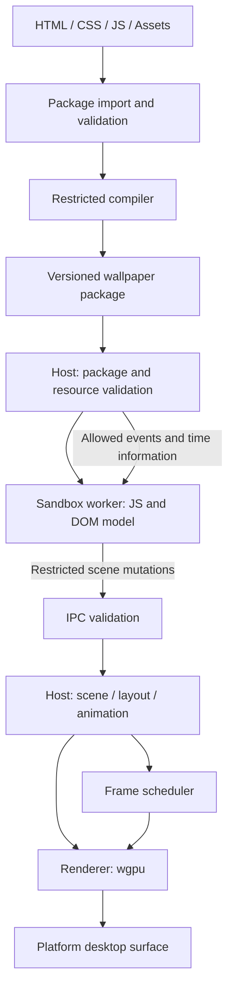

# Sahne — Project Architecture

## 1. Purpose and scope

Build a Rust-based engine that lets users create animated desktop wallpapers with a restricted subset of HTML, CSS, and JavaScript.

Platform priorities are **Windows first, followed by stable Linux support on selected mainstream distributions and desktop environments**. Android is deferred until the desktop milestones are complete. macOS remains a possible future target. Neither Android nor macOS blocks the initial desktop release.

Linux support is defined by tested distribution, release, desktop environment, display server/compositor, and graphics backend combinations. Supporting every distribution or compositor is outside the initial scope. See [Linux support plan](linux-support.md) for the initial candidate matrix and release criteria. Candidates are implementation targets, not verified support claims.

This project is not a browser. It does not aim to run arbitrary websites, React applications, or Three.js content unchanged. The supported web subset is a versioned contract.

HTML/CSS is converted into a validated scene description. JavaScript is not translated into Rust; it runs in a separate restricted process. Performance targets require comparative measurements; Rust alone does not guarantee better performance.

See [Feasibility research](feasibility-research.md) for sources, unresolved assumptions and technical validation gates. M0's hosted CI/development release and M1's targeted Windows rendering/lifecycle checks have recorded evidence. M2's fixed trusted sandbox/IPC spike is complete; [its acceptance record](m2-acceptance.md) distinguishes initial G2 evidence from the still-open production gate. Arbitrary content, complete platform matrices, content integration and Linux validation remain pending.

See [Development roadmap](roadmap.md) for task sequencing, milestone dependencies, completion evidence, and release readiness.

## 2. Core decisions

| Area | Decision | Rationale |
| --- | --- | --- |
| Main language | Rust | Shared infrastructure for core and platform layers |
| Rendering | Narrow custom renderer built on wgpu | Control over GPU resources and frame scheduling |
| Content model | Restricted HTML/CSS and a custom DOM API | Explicit, manageable scope |
| JavaScript | rquickjs 0.14.0 in trusted M2 Windows fixtures; QuickJS-NG snapshot pinned in the dependency review | Product APIs/untrusted content remain pending; traceable engine updates |
| Compiler output | Versioned scene data, assets, and JavaScript source | Preprocessing without generating native Rust code |
| Isolation | Separate worker inside an OS sandbox | Security boundary beyond JavaScript runtime isolation |
| GPU access | Managed by the host | No direct native GPU API exposed to the worker |
| Scheduling | Driven by changes and deadlines | Reduce unnecessary frames and CPU wakeups |
| Platform rollout | Windows, then selected Linux configurations | Prove desktop reliability before mobile expansion |

Libraries are implementation candidates. Published versions, licenses, maintenance, target builds, and integration must be verified before adoption. Pin the engine revision, enabled features, toolchain, and dependency lockfile. The current rquickjs source tree uses QuickJS-NG; do not assume a published crate embeds the same revision as its main branch.

## 3. System overview



The host treats compiler and worker output as untrusted. It independently validates package data and every IPC message within its own limits.

## 4. Components and responsibilities

### 4.1 Package compiler

- Parse the manifest, HTML, and CSS files.
- Report unsupported features with file and source-location information.
- Generate static styles and the initial scene.
- Resolve asset references and reject paths outside the package.
- Include format version, API version, and content hashes in the output.

The compiler does not replace the security boundary. Imported compiled packages are validated again. Untrusted parsing, image decoding, and font processing should run in restricted helper processes with explicit budgets. Source-location reporting and HTML error recovery must be validated in a parser spike.

### 4.2 Core

- Scene tree with stable identities and validated property types.
- Style precedence, inheritance, and supported selectors.
- Layout, change tracking, and animation state.
- Resource definitions and lifecycle.
- Data models independent of the platform and JavaScript engine.

The worker owns the script-visible DOM model. The host owns the authoritative rendering scene, containing accepted changes only. Shared identities and ordered transaction batches connect the models. The first API excludes synchronous layout and computed-style reads across this boundary.

### 4.3 Sandboxed worker

- Run the selected JavaScript engine and expose element lookup, text/style updates, events, and timers.
- Expose no filesystem, process-launch, network, or native-module APIs.
- Apply execution budgets and runtime memory limits.
- Bound callbacks, timers, Promise/microtask work, and pending messages.
- Send DOM mutations to the host in batches.

Use engine interrupts for cooperative execution limits and an independent host watchdog to terminate an unresponsive worker, including native-code stalls. Host callbacks must also perform bounded work. Memory policy covers process memory and native allocations as well as the JavaScript heap. Worker restart attempts are limited.

### 4.4 Host

- Start, monitor, and terminate workers.
- Manage package selection, permissions, resources, and user settings.
- Validate IPC schemas, sizes, ownership, and state transitions.
- Coordinate scene state, layout, native animation, and rendering.
- Respond to display, DPI, suspend/resume, and desktop changes.
- Preserve the last valid scene or display a safe fallback after worker failure.

### 4.5 Renderer

- Draw geometry, text, images, and gradients within the supported contract.
- Manage texture atlases, batching, and GPU caches.
- Run transform and opacity animation without script calls where possible.
- Recover from device loss and recreate surfaces.

Initially, any change may redraw the entire surface. Unchanged frames are not rendered. Add partial redraw only after measurements show a real GPU benefit. Group opacity, clipping, alpha compositing, transform order, and stacking behavior must be specified; applying opacity independently to children does not implement group opacity.

### 4.6 Platform adapters

The common interface covers attachment, detachment, surface size/DPI changes, monitor lifecycle, and visibility signals.

The Windows adapter manages a window behind desktop icons. WorkerW can depend on undocumented Explorer behavior and stays in an isolated module. Support reattachment after Explorer restarts and a normal-window development mode. Surface lifetimes must follow the underlying native window lifetime.

Linux uses separate X11 and Wayland integration paths where required. Distribution names alone do not define wallpaper compatibility: GNOME, KDE Plasma, Cinnamon, and their display-server sessions must be evaluated separately. Layer-shell support must be detected rather than assumed. Desktop-specific integrations are allowed behind the common adapter interface. Prioritize the candidate configurations in [Linux support plan](linux-support.md); publish support only after their validation gates pass.

Android is a deferred adapter and application-lifecycle project. A future implementation would use WallpaperService/Engine, a native rendering bridge, and Android-specific worker isolation. Desktop process-launch and window-management code must not be assumed portable to Android.

## 5. Proposed repository structure

```text
Sahne/
├── Cargo.toml
├── crates/
│   ├── wallpaper-core/       # Scene, styles, layout, animation
│   ├── wallpaper-format/     # Manifest, package schema, versioning
│   ├── wallpaper-compiler/   # HTML/CSS validation and scene generation
│   ├── wallpaper-protocol/   # IPC messages, limits, validation
│   ├── wallpaper-runtime/    # JS engine and restricted DOM API
│   ├── wallpaper-renderer/   # wgpu, text, images
│   ├── wallpaper-platform/   # Windows and selected Linux integrations
│   └── wallpaper-sandbox/    # Process launch and OS policies
├── apps/
│   ├── wallpaper-host/
│   ├── wallpaper-worker/
│   └── wallpaper-cli/        # Package validation and development tools
├── examples/
│   ├── static-scene/
│   ├── clock/
│   └── animated-shapes/
├── docs/
│   ├── architecture.md
│   ├── feasibility-research.md
│   ├── linux-support.md
│   ├── supported-features.md # Planned
│   ├── scripting-api.md      # Planned
│   ├── package-format.md     # Planned
│   └── threat-model.md       # Planned
└── benchmarks/
```

This shows intended responsibility boundaries. The first prototype may use fewer crates and separate responsibilities through modules.

## 6. Supported content contract

| Feature | First prototype | First product release target |
| --- | --- | --- |
| Elements | div, span, img | Same restricted element set |
| Layout | Absolute positioning, fixed dimensions | Percentage dimensions and a Flexbox subset |
| Styles | Color, background, text size | Gradients, limited borders and corner rounding |
| Selectors | ID and class | Simple type selectors and explicit inheritance |
| Animation | Opacity, translate, scale | CSS keyframes for supported properties |
| JavaScript | Element lookup, text/style changes, timers | Restricted events and a requestAnimationFrame-like API |
| Media | Static images | Additional budgeted formats evaluated separately |
| Network / filesystem APIs | None | None by default |
| Canvas / WebGL / SVG / Grid | None | Separate scope decision |
| Custom shaders | None | Separate security and cost evaluation |

Unsupported features produce clear errors instead of being silently ignored. Document cascade, units, font fallback, animation behavior, and the meaning of span/text boxes. Browser-identical behavior is not promised.

Before implementation, define document wrappers and style/script loading, UTF-8, allowed attributes, unique IDs, external URL rejection, box sizing, whitespace, wrapping, shorthand rules, and animation-versus-script precedence. Keep mixed inline text flow outside the prototype unless explicitly included in the contract.

## 7. Package format

Example source package:

```text
example-wallpaper/
├── manifest.json
├── index.html
├── style.css
├── script.js
└── assets/
    └── background.png
```

Draft manifest fields:

```json
{
  "formatVersion": 1,
  "apiVersion": 1,
  "id": "example.clock",
  "name": "Minimal Clock",
  "entry": "index.html",
  "script": "script.js",
  "permissions": [],
  "preferredFps": 30
}
```

Compiled output contains the manifest, initial scene, style/animation data, JavaScript source, and an asset index. Version 1 accepts JavaScript source only and rejects externally supplied engine bytecode.

Package import checks path traversal, absolute paths, symbolic links/reparse points, file-count limits, total expanded size, and decompression bombs. Include Windows drive-relative paths, UNC paths, alternate streams, and case collisions in path validation. Avoid reopening validated resources by mutable path names. Limit decoded image dimensions and total decoded memory as well as file size. Content hashes provide integrity and caching, not proof of a trusted publisher.

## 8. Draft scripting API

```js
const clock = document.getElementById("clock");

function updateClock() {
  clock.textContent = wallpaper.time.format("HH:mm");
}

updateClock();
setInterval(updateClock, 1000);

wallpaper.on("pause", () => {});
wallpaper.on("resume", () => updateClock());
```

The application supplies document, timers, and wallpaper. Browser APIs are not automatically available. Specify time-zone and locale behavior for formatting. Animation uses monotonic time; calendar time is separate.

This introductory example polls once per second. A production minute-only clock should schedule its next update at the next minute boundary to avoid unnecessary script wakeups.

Synchronous getBoundingClientRect, offsetWidth, and computed-style reads are outside the initial API. A future asynchronous, revision-tagged layout snapshot may be considered.

Audio analysis and network access are outside the first release. Future capabilities require an explicit permission model and data minimization.

### Post-roadmap wallpaper network access

After the current roadmap is complete, evaluate an optional HTTPS data API for native and imported web wallpapers. The candidate design keeps direct network access disabled in the worker. A restricted helper would make bounded requests to public endpoints approved by the user for each wallpaper. Permissions would be off by default and revocable.

The initial design should evaluate fixed, credential-free GET requests for data feeds such as weather. Exclude local and private network destinations, including on redirects, and set limits on request frequency, duration and response size. Treat responses as untrusted data and exclude remote script execution. Review privacy and abuse independently of filesystem isolation. Remote services can observe the connection's public IP and request timing, and request parameters can carry data available to the wallpaper.

## 9. IPC and consistency

- Use typed, length-bounded messages; do not deserialize arbitrary objects.
- Include protocol version, session ID, sequence number, and base scene revision.
- Allow restricted operations such as SetText and SetStyle, never native addresses, filesystem paths, or GPU commands.
- Validate node ownership, identity generation, property types, numeric ranges, and finite numbers.
- Validate an entire transaction before applying it atomically; no partial acceptance.
- Bound all queues, including acknowledgements and errors. Apply backpressure and coalesce updates only when operation ordering remains correct.
- Keep a bounded number of ordered pending batches. Commit accepted state after the host acknowledgement. Initially, a rejected batch closes the session cleanly instead of attempting complex rollback.
- Define a temporary worker-local view so scripts can read their own writes within a callback without claiming host acceptance.
- Refer to resources through host-issued IDs.

Enforce limits before decoding, during allocation/collection decoding, and after semantic validation. Logs and diagnostic messages also have budgets.

## 10. Sandbox and threat model

Untrusted inputs include source packages, compiled scenes, JavaScript, images, fonts, and worker messages. The OS, host, and graphics driver are part of the trusted computing base; minimize exposed attack surfaces.

On Windows, evaluate AppContainer/LPAC, Job Objects, and restricted handle transfer together. Grant no network capability and expose only required IPC resources. Job Objects alone are not a security sandbox. Validate process launch, file permissions, and IPC ACLs in the actual restricted process.

Exposing no filesystem API to scripts does not imply the OS process can read no files. Document required executable/library/system-resource access and test unauthorized access through direct OS calls inside a trusted sandbox test harness.

On Linux, combine namespaces, seccomp, and Landlock where available with resource limits. Availability depends on distribution and kernel policy. Establish a tested sandbox profile for every supported configuration. If mandatory isolation is unavailable, untrusted content must not silently run with weaker protection.

Initially, use one worker per wallpaper session. A worker failure must not terminate the host or other sessions. Sharing workers across monitors may be evaluated later while preserving isolation and resource ownership.

Resource limits are host policy and cannot be increased by packages. Cover process memory, JavaScript execution time, timers/callbacks/microtasks, scene nodes, text length, IPC size/rate, texture dimensions, decoded assets, and FPS. Determine final values through benchmarks.

## 11. Frame scheduling and performance

The scheduler computes the next required wakeup from scene changes, active animation, script callback deadlines, and platform events.

| State | Behavior |
| --- | --- |
| Static scene | Render once, then wait for a change or surface event |
| Minute clock | Render only when displayed text changes |
| CSS animation | Advance native animation at the configured FPS limit |
| Script animation | Budget callbacks and batch scene mutations |
| Fullscreen application | Pause according to policy and available visibility signals |
| Display off / session locked | Pause scripting and rendering |
| Resume | Apply explicitly defined animation and timer semantics |

Do not replay an unlimited backlog of missed timers. Bound catch-up steps for fixed-timestep simulations. Visibility detection may be imperfect; let users change pause policy. Distinguish no redraws from no CPU wakeups.

Benchmark static images, a digital clock, transform/opacity animation, and a dense moving scene against a WebView reference at the same resolution, FPS, visual quality, and hardware. Measure all host/worker/helper processes together: RAM, CPU, GPU time, frame-time distributions, idle wakeups, and startup. Publish measured results rather than assuming an advantage.

## 12. Implementation candidates

| Task | Candidate | Boundary |
| --- | --- | --- |
| HTML parsing | html5ever | DOM and product semantics remain custom |
| CSS parsing | cssparser initially; Lightning CSS as an alternative | Neither supplies the full style/layout/painting system |
| Layout | Taffy | Style mapping and drawing remain custom |
| JavaScript | rquickjs with a pinned bundled engine revision | Requires OS sandbox and resource policy |
| GPU | wgpu | Requires a 2D layer and scene renderer |
| Text | cosmic-text and compatible glyphon | Font resources and atlas budgets remain application responsibilities |
| Data models | serde | Requires schema validation and size limits |

Research identified wgpu 30.0.1, glyphon 0.12.0, and cosmic-text 0.19.0 as a dependency-compatible candidate set. This is not a completed build validation. See the research report for the version and license snapshot.

## 13. Development phases and acceptance criteria

### Phase 0 — Contract and security design

Write the supported HTML/CSS list, scripting API, package/protocol schemas, and threat model. Run a small Windows sandbox/IPC spike. Record the Linux candidate matrix and integration risks early, especially GNOME and Plasma paths.

**Acceptance:** Feature boundaries and validation gates are explicit; direct OS access and process isolation tests are defined. Linux candidates are distinguished from verified configurations.

### Phase 1 — Windows rendering prototype

Draw shapes, text, and images in a normal development window and behind desktop icons. Handle size/DPI changes and Explorer restarts.

**Acceptance:** Static scenes have no continuous render loop; window lifecycle changes do not crash the application. Pass research gate G1.

### Phase 2 — Restricted HTML/CSS and animation

Compile HTML/CSS into the initial scene. Add absolute positioning, basic styles, and transform/opacity keyframes.

**Acceptance:** Unsupported features produce useful errors; example scenes match their expected appearance. Pass research gate G3.

### Phase 3 — Sandbox worker and JavaScript

Integrate the selected engine, restricted DOM, timers, microtask budgets, IPC, and resource limits. Enable untrusted content only after sandbox validation.

**Acceptance:** Infinite loops, memory exhaustion, IPC floods, native stalls, and worker crashes do not take down the host. Unauthorized file/network access is blocked. Pass research gate G2.

### Phase 4 — Desktop product foundations

Add package import, error screens, settings, multiple monitors, caches, and pause policies. Optimize using measurements.

**Acceptance:** Malformed packages are rejected safely; long runs do not show unbounded memory/GPU resource growth. Record reproducible reference comparisons and pass research gate G5 before making performance claims.

### Phase 5 — Stable Linux support on selected configurations

Implement platform and sandbox adapters for the candidate distribution/desktop/session matrix. Prioritize default desktop sessions on Ubuntu LTS, Fedora Workstation, Linux Mint Cinnamon, Debian stable, and Kubuntu LTS. This is a practical initial selection, not a measured popularity ranking. Confirm exact release/session versions during Linux planning.

GNOME integration is an explicit work item. Passing a layer-shell test on another compositor does not satisfy the Ubuntu/Fedora GNOME targets. A gap remains visible until implemented and validated; support may be released per configuration.

**Acceptance:** Pass gate G6 and the stability checklist in [Linux support plan](linux-support.md). Publish the exact tested matrix and known limitations. Keep core and package semantics shared across platforms.

### Phase 6 — Deferred mobile evaluation

After the Windows and selected Linux milestones, revisit Android service lifecycle, native surfaces, isolation, and device/energy testing. Its future gate G4 does not block desktop development or releases. macOS requires a separate future scope decision.

## 14. Validation approach

- Malformed-input and fuzz testing at parser, archive, and IPC boundaries.
- Behavioral tests for style precedence, layout, and animation timing.
- Visual comparisons for text, images, and animations.
- Real sandbox tests for files, network, handle/descriptor transfer, and resource exhaustion.
- Explorer restart, monitor hotplug, DPI changes, lock, and suspend/resume tests.
- Linux desktop/session lifecycle, package installation, kernel sandbox support, and display-backend testing on the declared matrix.
- Repeatable benchmarks and long-duration resource monitoring.

## 15. Open decisions and risks

1. **Feature scope:** Flexbox, wrapping, and font behavior substantially affect workload.
2. **Rendering:** Measure the narrow custom 2D layer before committing to a broader rendering library.
3. **Windows integration:** Explorer behavior needs version-specific regression coverage.
4. **Linux integration:** Mainstream distribution coverage requires desktop/compositor-specific work and an explicit tested matrix.
5. **Sandbox:** OS isolation, engine updates, and native parsers require continuing maintenance.
6. **Compatibility expectations:** Web syntax can imply browser compatibility; expose the supported contract in tooling.
7. **Performance:** Lower RAM/CPU remains a hypothesis until measured on equivalent workloads.
8. **Deferred platforms:** Android and macOS have no initial delivery commitment.

The first milestone remains a small Windows end-to-end prototype: idle when static, animate supported properties, and run a clock script inside a validated sandbox. The next platform milestone is stable support for the selected Linux configurations.

## 16. M0 implementation snapshot

The initial workspace contains only apps/wallpaper-cli; other crates remain planned. Rust 1.99.1 is pinned, with no external Rust dependencies. The CLI exposes help/version only. CI checks Windows builds; release pushes are configured to publish development prereleases, not stable product builds. See [Development guide](development.md), [Dependency review](dependency-review.md), [Content contract](supported-features.md), [Scripting contract](scripting-api.md), [Package and IPC contract](package-format.md), and [Threat model](threat-model.md). Contracts remain drafts for the technical spikes.

## 17. M1 implementation snapshot

The workspace adds apps/wallpaper-preview and crates/wallpaper-platform. The preview renders only a trusted built-in shape, text and RGBA image with wgpu/D3D12, winit and glyphon. The Windows adapter creates an Explorer WorkerW child window before GPU surface creation and bounds reconnect attempts. Native FFI stays in the platform crate; its narrowly documented unsafe-lint exception does not apply to CLI/preview or future workers. Text now uses a single embedded Noto Sans font and a dedicated font database; no external input is exposed. See [Font provenance](bundled-font.md). Per-monitor layout, full device recovery and G1 lifecycle certification remain pending. See [M1 preview](m1-preview.md) and [Dependency assessment](m1-dependencies.md).

### M1 lifecycle refinement

The preview uses generation-tagged device-loss notifications to rebuild native/GPU state and ignore stale callbacks. Desktop ownership checks include PID and class; periodic size checks update the child surface. Real faults and synthetic teardown share a bounded run-wide recovery budget. No dependency or sandbox policy changed. Ten actual Explorer restart cycles each reached a new presented generation; hardware GPU loss and the remaining display/power matrix are not certified. See [Lifecycle validation](m1-lifecycle-validation.md).

## 18. Planned Wallpaper Engine import boundary

Compatibility planning proceeds alongside native development; importer implementation starts only after M4's compiler and sandboxed scripting path work end to end. The first target is a declared subset of local web-project conversion and explicit compatibility reporting. A separate frontend translates supported metadata/assets into Sahne's validated package format; a narrow API adapter stays within existing worker/host permissions. Core scene, renderer and sandbox behavior remain authoritative.

During M2/M3, specify capability reporting, settings/default/update semantics, host-capped FPS, pause behavior and source provenance. Do not silently supply browser APIs or expand the feature contract to fit a complex example. Canvas/WebGL/audio/network and dynamic filesystem access remain separate scope decisions. Scene PKG/TEX extraction is a later independent track; extraction does not imply scene/SceneScript playback. No browser backend is currently selected.

samples/ contains ignored optional local research inputs, never CI prerequisites or release contents. Static findings and required original synthetic fixtures are documented under docs/. Original samples remain unmodified and unexecuted during inspection. See [Import plan](wallpaper-engine-import-plan.md) and [Sample assessment](wallpaper-engine-samples.md). This is an approved planning boundary, not implemented compatibility support.

### Application-device recovery validation

A dedicated test mode destroys only the preview's own wgpu device. Generation-tagged callbacks plus a later-generation presented frame are required for success. Normal and desktop runs passed on the recorded RTX 3050 configuration. The fixed font is now embedded with its OFL notice and loaded without system discovery. No new Rust dependency or relaxed isolation policy was introduced. Real driver loss, hotplug and changed-DPI behavior remain separate unverified cases.

## 19. M2 control-frame foundation

The workspace now includes crates/wallpaper-protocol as a safe std-only transport-neutral codec for bounded Hello/Ping/Pong/Reject control messages and a test-only ProbeResult. Encoding and complete structural validation are independent from OS channel security and host state acceptance; envelope checks do not mutate scene/sequence state. Scene transactions remain planned M4 work. See [M2 wire contract and tests](m2-protocol.md).

## 20. M2 trusted Windows sandbox experiment

apps/wallpaper-sandbox-probe uses crates/wallpaper-sandbox to stage its own trusted executable in a fresh directory, create a unique standard AppContainer with zero capabilities and transfer only two explicitly listed pipe endpoints. The native crate has the same narrow unsafe-FFI exception as wallpaper-platform. Safe application crates retain the unsafe prohibition. Windows creates the suspended worker in a kill-on-close Job with a one-process limit and 256 MiB process memory limit. The host verifies Job membership and the actual token, profile and capabilities before resuming it. ACL changes apply only to the fresh executable staging directory and exact profile SID. A curated OS-location environment excludes inherited credentials, proxies and PATH.

One bounded control conversation has independent host deadlines and failure cleanup; no JavaScript, package import, renderer integration or worker restart is enabled. Direct sentinel file and host VM-open denial, native stall termination, oversized-prefix rejection and controlled worker exit have local evidence. Network testing returned a timeout rather than explicit access denial; LPAC, broader OS access, memory/CPU/IPC exhaustion and integrated G2 remain open. This experiment does not establish a production launch policy. See [Sandbox boundary, commands and evidence](m2-sandbox.md).

The next trusted-probe continuation adds independent outbound TEST-NET-1 TCP and Job memory cases. Outbound TCP requires explicit Windows denial, while the original loopback timeout remains inconclusive. The memory helper queries the actual worker Job, verifies a small committed allocation succeeds and one request above the unchanged 256 MiB limit fails, then requires normal IPC and exit. Only the existing windows-sys Memory API binding feature is added; no package, capability or resource limit changes. These are narrow native checks, not full network/exhaustion or JS validation.

Further trusted fixtures query the one-process Job quota and attempt suspended creation of the staged executable, and test exclusion of an intentionally inheritable host sentinel handle from the explicit list. The host keeps that file open and independently queries the worker's strict-handle mitigation before resume. The handle test validates an armed IPC stage before accepting either a returned invalid-handle report or the exact strict-policy fatal exit; ordinary crashes/EOF/timeouts remain failures. Only the intentional-fault worker suppresses its own WER invocation; no mitigation or deadline is disabled. Existing windows-sys SystemServices/Diagnostics_Debug bindings supply these calls without changing external versions. Broader process/handle/endpoint and integrated G2 coverage remain pending.

The one-shot probe conversation now ends only at clean EOF after its final result. The first trailing byte is a typed rejection; the host does not drain or queue unsolicited frames. The independent deadline also covers incomplete frame bodies and a peer retaining an open stream after a valid report. New restricted-worker fixtures cover unsolicited-message flood, partial-body stall/EOF, replayed sequence and non-closing output. No dependency, launch capability or resource limit changes. This fixed conversation is not a persistent transaction/rate-control implementation; see [IPC fault evidence](m2-ipc-validation.md).

## 21. M2 fixed JavaScript engine fixtures

The Windows sandbox probe now links rquickjs 0.14.0 with only std and constructs an engine only inside its AppContainer worker, after the existing handshake and an additional worker self-check. Published Rust source is pinned at d7ef5eeae702fea24c03643064de454f1c1dd4b0 and the bundled QuickJS-NG C snapshot at 0fdea21ff1090084e91dad812b343d92e79ba9d9 (header version 0.16.2). The private safe script module evaluates five fixed original source literals; no source path, package, external bytecode or native module is accepted. The host has no engine execution path.

Context construction installs base objects plus Eval/Promise only, without a module loader or host APIs. Spike policy sets 16 MiB engine allocation, 256 KiB JS stack, one cumulative 100 ms cooperative deadline and at most 64 explicit Promise jobs. Context/runtime teardown discards pending work; independent host/Job protection is unchanged. Fixtures require exact arithmetic/API absence, actual interrupt activation, OOM, stack RangeError or a still-pending queue at the job cap before reporting success. Source parsing and engine work stay in the restricted worker; no DOM/rendering integration is enabled.

The dependency review records exact archive checksums, C-source comparisons, upstream security-policy risk, published C advisories and unchanged existing Rust advisories. Four registry packages are added to the lockfile, including inactive relative-path; existing hashbrown feature unification changes are documented. No application unsafe exception is added. G2 is still partial; arbitrary content, per-callback policy, persistent IPC/restarts and broader isolation remain pending. See [JS fixture behavior](m2-js.md) and [dependency/security review](m2-js-dependencies.md).

## 22. M2 bounded restart experiment

The probe adds an explicit supervisor for fixed recovery fixtures, with a run-wide cap of three launches, minimum 100 ms monotonic backoff and no budget reset on handshake or time advancement. Only timeout or an observed failed exit associated with EOF can retry. Protocol/schema/context/body/trailing-data failures and launch/security errors stop permanently; a valid one-shot JS result stops successfully. Attempt-number checks reject stale or duplicate host completions.

A shared ProbeAttempt owner scopes process/Job/profile, channel/reader and deadlines. Explicit stop/wait/join and owner destruction precede any replacement; new attempts use fresh identity, Job, profile and pipes. Missing Hello no longer incurs an additional response wait. Classification and explicit stop/join have an observational one-second bound after the response result is seen. Best-effort profile deletion and OS launch timing remain separate limitations. An internal fixture injects a previous session into a new channel and must be permanently rejected after a valid new handshake. No new wire kind, dependency, permission, product source loading or renderer recovery is enabled. See [Recovery policy and evidence](m2-recovery.md).

## 23. M2 unrelated endpoint and I1 boundary

A trusted endpoint fixture creates two instances of one fresh local named pipe with a protected host-user-only DACL and remote-client rejection. The host holds a successful duplex positive connection while one instance remains available; all endpoint handles stay non-inheritable/outside the worker handle list. The AppContainer must receive access-denied for read, write, duplex and zero-access opens, while its permitted anonymous IPC succeeds. The host then destroys the owning sandbox and requires the pipe name to be absent. This adds no permitted service or imported capability. See [Scoped endpoint evidence](m2-endpoint.md).

The M2 portion of I1 now specifies a separate import-adapter capability/inspection boundary: requirements/reports never grant permissions, inspection executes no source, raw paths/handles do not become worker APIs, and host limits/native validation remain authoritative. The report shape is a proposed sidecar, not a new accepted native schema. M3 mappings/callback semantics and I2 implementation remain pending. See [Import adapter boundary](import-adapter-boundary.md).

## 24. M2 permitted channel hardening

Both actual anonymous control pipes now use explicit protected host-user-only DACLs. Before every launch the host reads back the descriptors and requires the exact requested single ACE. It replaces the non-inheritable creation handles with data-direction plus SYNCHRONIZE handles, closes the originals, clears inheritance on parent endpoints and retains the explicit two-endpoint worker handle list. No package SID grant, metadata/ACL handle right or permissive fallback is introduced.

The fixed ipc-rights worker fixture requires direct OS denial of DACL reads/changes, attempts to regain ACL/pipe-instance rights through handle duplication, and reverse-direction data operations on its actual inherited stdin/stdout, followed by normal protocol/EOF/exit success. Existing frame/deadline/one-slot result bounds and attempt cleanup remain authoritative; persistent source/scene channels and broader G2 remain open. The DACL does not protect against trusted host-user/admin code. No dependency, capability, resource-limit or content-loading change is made. See [Control channel policy, bounds and validation](m2-ipc-security.md).

## 25. M2 filesystem boundary experiment

The fixed filesystem case stages original synthetic private/read-only files. Only its fresh private directory/file receive protected host-user-only DACLs; staging retains the existing exact-profile read/execute grant. Host positive controls precede eleven worker file-right denials, private listing denial and four creation denials. Native FFI remains confined to wallpaper-sandbox, with the fixed filesystem matrix isolated in its windows/filesystem module.

The worker separately confirms staged text/executable reads, staging enumeration and a selected public Windows DLL header read. After stop/join, the host checks synthetic contents and namespace. These observations do not constitute a complete filesystem or loaded-library inventory. No existing user/system ACL, permission, dependency, arbitrary source path or resource limit changes. Broader G2 and production policy remain open. See [Filesystem matrix and permitted reads](m2-filesystem.md).

## 26. M2 explicit profile-storage cleanup

The native Profile owner resolves its actual SID's data directory, binds the returned path to its generated profile root and verifies a nonempty synthetic storage control before launch. After Job stop/wait and reader join, normal completion explicitly deletes the owned OS profile and requires the previously observed root to be absent. Errors propagate before recovery admits another worker. Drop remains a best-effort fallback for partial construction/early failure.

Deletion timing is separate from the existing one-second classification/stop/join check; synchronous OS profile calls have no new hard deadline. The audit covers storage-directory absence and deletion API success, not independent registry/hive enumeration or abnormal host death. Existing windows-sys adds only the COM allocator binding feature required to free the returned path; no version, lockfile, capability or limit changes. See [Profile cleanup acceptance and limits](m2-profile-cleanup.md).

## 27. M2 host write-pressure containment

The host now owns one dedicated writer and one reader per attempt, with ownership installed before fallible thread creation. The main deadline/control thread performs no pipe write. Finish stops/waits the worker, joins both I/O threads, validates writer completion and verifies profile cleanup before replacement. The existing one-second classification/stop/join acceptance includes both threads; profile timing stays separate.

Two fixed transport fixtures compare a worker that drains/verifies a bounded 1 MiB raw tail after Ping with a worker that sends Hello but never reads input. The stalled writer must remain pending at the response deadline and be released with a documented pipe-closure error after Job termination. No persistent queue, arbitrary source payload, wire kind, dependency or permission is added. See [Host write budget, positive control and limits](m2-host-write.md).

## 28. M2 CPU hard cap and detached launch

Probe Jobs now apply and read back ENABLE | HARD_CAP CPU scheduling before process creation: 10% normally and a stricter 1% for fixed native CPU stress. The CPU case verifies its immediate policy and armed control stage, then spins until the existing host deadline. The host requires measurable bounded Job user+kernel CPU, a live worker and an exact single-worker Job PID list before stop/join/profile cleanup. Total-time quota termination is not claimed; rate and wall-clock watchdog remain separate mechanisms.

PID inspection found an implicit conhost.exe under the earlier CREATE_NO_WINDOW launch. DETACHED_PROCESS now keeps these workers console-free while retaining the same inherited pipe endpoints and one-process/memory limits. Later console allocation and other broker access remain unverified. No new dependency, feature, wire kind or unsafe application exemption is introduced. See [CPU policy, measurements and console finding](m2-cpu-rate.md).

## 29. M2 reproducible validation and manual CI

A Windows/PowerShell runner now builds the trusted probe and executes its fixed thirty-case corpus with explicit expected launch/cleanup counts. A separate outer host deadline/output guard, bounded log reader and strict evidence checks produce JSON/Markdown provenance reports under ignored target/. Native sandbox assertions remain authoritative; report success does not certify G2 or enable untrusted content.

A manual-only windows-2025 workflow reuses the existing pinned checkout action and runs runner/Rust/native checks with read-only permissions. Reports are retained as the job summary and bounded workflow-log output; no new artifact action or release behavior is added. Hosted execution remains unverified. See [Runner commands, failure behavior and evidence](m2-validation-runner.md).

## 30. M2 synthetic registry boundary

A fixed registry fixture creates one fresh volatile, protected host-user-only key in HKCU/Software's 64-bit view. Host access/create/delete controls precede ten direct AppContainer denials. After worker stop/I/O joins, the host verifies only its original synthetic value/namespace, closes/deletes the owned key and requires absence. Registry-specific handle owners and a non-recursive bounded fallback keep cleanup scoped to this instance; failures prohibit success/retry.

No registry handle, capability or general registry API is granted to scripts. Only the existing windows-sys Registry binding feature is added; package versions and lockfile remain unchanged. Runner schema 2 records mandatory registry cleanup, with thirty-one default cases/thirty-seven worker launches. This fixture does not audit AppContainer registry registrations or certify broader registry isolation. See [Registry matrix and cleanup scope](m2-registry.md).

## 31. M2 loopback diagnostic evidence

The fixed loopback fixture now proves its listener with a host connection before worker launch. A separate elevated diagnostic reads existing WFP events scoped to that listener and verifies receiving-host identity/time/endpoint and an AppContainer Loopback App Isolation block. It changes no firewall or buffering policy. A timeout alone continues to fail the native case; supplemental local drop evidence and its limitations are reported separately, without completing G2. See [Loopback diagnosis and repeatable evidence](m2-loopback.md).

## 32. M2 incremental commit pressure

A fixed trusted worker retains bounded 16 MiB regions until native allocation denial under the unchanged 256 MiB Job cap, checks explicit release and a recovery allocation, then completes normal IPC/exit. The host independently verifies Job peak commit and single-worker accounting. No new wire type or dependency is introduced. See [Incremental memory acceptance and limits](m2-incremental-memory.md).

## 33. M2 bounded multi-message control channel

Fixed transport fixtures extend the existing Ping/Pong codec to at most 128 sequential exchanges in one session. A reader-owned one-slot command queue feeds the dedicated writer, with one outstanding request, refreshed host nonces and a cumulative response deadline. Queue saturation fails immediately; dropping the sole sender releases an idle writer during stop/join. Normal completion requires both EOFs; mid-session replay/stall tests exercise failure after valid progress. No scene/source channel or production callback scheduler is added. See [Roundtrip protocol and validation](m2-roundtrip.md).

## 34. M3 resolved scene foundation

A safe dependency-free wallpaper-scene crate owns an experimental flat scene model, bounded binary codec and independent numeric/identity/resource/text validation. Only immutable validated values can be encoded; decoding always revalidates. Scene-local IDs reference declared image metadata without paths or live host handles. A fixed CLI self-check exercises roundtrip validation without opening source/assets or rendering. HTML/CSS, hierarchical compositing, resource decoding, animation and production transport remain pending. See [Scene schema, budgets and validation](m3-scene.md).

## 35. M3 manifest and retained source entries

The safe wallpaper-format crate validates strict typed native manifests and owns immutable in-memory source entries. Portable relative paths, exact-case references, collision/file-parent rejection and aggregate count/byte limits precede compiler use; it performs no filesystem/archive access or execution. Original fixed positive/negative cases now exercise this parser in the existing AppContainer. serde_json/serde adoption and its exact graph/security/license assessment are recorded separately. See [Manifest/source contract](m3-manifest.md) and [dependency review](m3-json-dependencies.md).

## 36. M3 strict fragment compiler

A safe wallpaper-compiler crate parses a bounded explicit HTML fragment/CSS subset without browser recovery, resolves per-property ID/class/inline cascade and selected inheritance, accumulates absolute fixed-pixel layout and validates flat scene output. Author symbols map to one or more scene-local primitives; optional JS remains a deferred source association. Original checked-in sources are embedded for CLI and AppContainer checks, without arbitrary file input. Images, hierarchical effects, hashed compiled packages and animation remain open. See [Exact grammar, limits and diagnostics](m3-compiler.md).

## 37. M3 compiled static window preview

An optional trusted preview mode compiles the original embedded sources and independently validates the scene before drawing. Aligned per-node uniforms and interleaved rectangle/Glyphon commands preserve flat scene order; a fitted fixed canvas and bounded text boxes define this initial visual reference. The original M1 mode and lifecycle controller remain. No external source/resource loading, image decoding, hierarchical effects or animation was enabled in that revision. See [Observed reference, rendering rules and untested combinations](m3-preview.md).

## 38. M3 bounded PNG resources and fixed image preview

The safe wallpaper-media crate validates a narrow PNG container before decoding: encoded/chunk/dimension/decoded-byte bounds, every chunk CRC, RGBA8 non-interlaced pixels and no unsupported metadata/animation. Immutable pixel assets are independently matched to validated scene resource IDs/dimensions, with the existing aggregate budget. The compiler maps exact retained paths to shared resources, preserves image/background order and reports image failures at the source element. Original CLI and zero-capability AppContainer fixtures exercise this data path without enabling arbitrary input or changing Job/watchdog limits.

A separate trusted image preview implementation uploads validated RGBA to sRGB textures and interleaves texture/rectangle/text commands with nearest/clamped sampling. Local Windows image-window/resize, original static visual regression and image/static idle/recreation/device-loss checks passed on November 24, with limited references and exact case evidence recorded separately. Production helper/IPC integration, compiled hashes, hierarchical effects, animation, broader platform/DPI/hardware coverage and full G3 remain open. See [Image contract and local checks](m3-images.md) and [dependency/security/license review](m3-png-dependencies.md).

## 39. M3 version-2 group-data validation

A separate experimental scene revision retains ordered, contiguous group subtrees and primitive-local bounds. Iterative validation derives explicit begin/draw/end commands, accumulated axis translation/scale and canvas/ancestor clip intersections without flattening group opacity into leaf alpha. Depth, local/accumulated transforms, world coordinates and conservative opacity-intermediate reservations are bounded alongside existing scene/resource/text limits. The v2 codec independently rebuilds this state; version-1 APIs, compiler output and preview fixtures remain unchanged.

Original typed CLI/AppContainer fixtures exercise the boundary without enabling source effects or group rendering. Compiler mapping, independently validated v2 image assets, bounded GPU intermediates and overlapping-child visual acceptance remain required before rendered support. No native policy, unsafe exemption or external dependency is changed. See [Group semantics, wire schema and remaining gates](m3-groups.md).

## 40. M3 opt-in group source compilation

An explicit `compile_groups` path shares the bounded source/cascade/image machinery while producing v2 groups per authored element and local background/text/image draws. Author symbols identify groups; source indices map generated-layer validation failures back to HTML. A restricted opacity/transform/top-left-origin/overflow-clip grammar is enabled only in this mode. The existing `compile` path/default CSS parser and preview retain their v1 behavior and effect rejection.

Both scene revisions independently match decoded immutable image assets to declared resource IDs/dimensions. Original HTML/CSS/PNG CLI/AppContainer fixtures exercise the opt-in path without script execution, arbitrary file input, new dependencies or policy changes. Bounded GPU group compositing, visual effect acceptance, native animation and production integration remain open. See [Group compiler grammar, mapping and limits](m3-group-compiler.md).

## 41. M3 fixed group renderer and local validation

The literal trusted `groups` preview mode now independently validates v2 output/assets and plans bounded canvas, opacity and text surfaces before GPU allocation. Ordered multi-pass code paints straight primitives/images, then composites premultiplied opacity targets once at group boundaries. Per-operation ancestor clips use coarse scissors plus exact fragment tests. Text raster surfaces bridge Glyphon's scalar scale to native anisotropic transforms; a fitted fixed-canvas copy handles presentation resize. Scene, additional renderer texture/text and device/uniform bounds all apply without relaxing native policy.

CPU plan/compositing/shader tests pass, and the original group fixture has local Windows D3D12 visual overlap/clipping/resize evidence. Ten bounded lifecycle cases passed across group/static/image modes and the M1 baseline, including actual requested device-loss callbacks and restored frames. Scope remains the recorded fixture/hardware; the later additional-effect observations are recorded in section 42. The later fixed fractional GPU comparison is recorded in section 43; broader configurations, native animation, product/source-helper integration and full G3 remain open. See [Implementation, limits and local validation](m3-group-preview.md).

## 42. M3 additional effect fixture and local observations

A separate original `groups-effects` source package exercises nested opacity/inner clipping, anisotropic text/PNG scale with an untransformed control, and fractional/empty clips. The existing group renderer selects it through a fixed enum mapping, reusing the same algorithms, budgets and lifecycle path; prior literals/examples remain unchanged. CPU reference tests check independent scene/assets, target order, linear source-over samples, raster/world geometry and exact clip-center expectations. On November 25, local Windows D3D12 window/maximize/restore checks agreed visually with the original fixture, and seven bounded lifecycle/runtime checks passed. The later fixed GPU pixel/color comparison also passed locally (section 43); this limited evidence does not close full G3 or the platform matrix. See [Cases, expected samples and local evidence](m3-effect-fixtures.md).

## 43. M3 fixed root-texture pixel verification path

An effects-only development flag enables `COPY_SRC` on the native root texture and eighteen fixed one-pixel copies after compositing into a 4,608-byte readback buffer. Bounded submission polling/mapping feeds independent analytic sRGB/source-over expectations with fixed RGB tolerances and exact opaque alpha. The mode exits after a successful checked frame; errors/interruption cannot recover into a passing retry. Normal modes allocate no readback buffer or root copying permission, and no desktop/arbitrary-source read API is introduced. CPU checks and all eighteen fixed GPU samples passed locally on November 25 on NVIDIA RTX 3050 Laptop / D3D12. Fractional coverage samples matched exactly; blended RGB differed by at most one byte and every alpha was exactly 255. A separate normal/maximize/restore window run exited successfully. Broader hardware/configuration coverage and full G3 remain open. See [Command, boundaries, tolerances and remaining evidence](m3-pixel-check.md).

## 44. M3 typed native animation and explicit clock foundation

The safe scene crate now owns a separate typed animation model bound to one immutable validated v2 base. Bounded linear group translate/scale/opacity tracks undergo target/key/value checks, conservative whole-run ancestor transform envelopes and potential opacity-target reservations. Absolute active-time sampling skips missed frames, handles finite/alternate/infinite iteration boundaries and independently revalidates each resulting static hierarchy. A caller-owned monotonic clock excludes explicit paused intervals and rejects backward/overflow inputs atomically. No source grammar, animation wire format, renderer scheduling, platform pause subscription or worker capability is introduced; static scene codecs and previews retain their existing behavior. See [Native contract, timing, budgets, CPU checks and integration work](m3-animation.md).

## 45. M3 typed animation binding, wire envelope and fixed playback code

An opt-in compiler API binds bounded author names to v2 group symbols and validates a typed program without extending CSS grammar. A self-contained bounded scene/program codec independently revalidates the base and animation on decode; image assets still require their separate immutable validation and production IPC is unchanged. The literal animated-shapes preview selects original embedded HTML/CSS and five fixed native tracks. Application-owned playback combines independent pause reasons and capped WaitUntil redraw scheduling across GPU generations. Animated pass planning retains draw slots and reserves opacity targets through values 0/1; uniform updates require identical resource topology and text raster specifications. Steady frames do not resize GPU textures or text targets. CPU checks pass; local animated GPU/window and manual pause/recovery checks passed. Broader text-scale animation and full G3 remain pending. See [Wire schema, controls, resource policy, tests and pending observations](m3-animated-preview.md).

## 46. M3 compiled provenance fixture

The developer CLI streams a versioned record for the embedded v2 group fixture after independent scene and image validation. The record captures retained source bytes, scene bytes, author symbols, deferred script association and decoded RGBA. An external SHA-256 tool hashes the exact record bytes. General export and verification remain open. See [Record format and reproduction](m3-compiled-provenance.md).

## 47. M3 typed compiled provenance export

The compiler can produce a version 2 provenance record directly from a validated retained package and viewport. The record distinguishes flat, grouped and animated scene data and preserves the ordered ID list for each author symbol. The developer CLI exposes four built-in examples alongside the original version 1 group command. Export validation independently decodes each scene payload and checks its RGBA assets before writing. Receiver verification and disk package collection remain open. See [Compiled provenance](m3-compiled-provenance.md).

## 48. M3 compiled record receiver verification

The receiver regenerates the canonical record from its own retained package, viewport and compilation mode. It compares incoming bytes with a fixed 8 KiB buffer and requires EOF. A remote record cannot drive allocation sizes or supply the expected source snapshot. The fixture CLI verifies binary stdin for legacy and named exports. See [Receiver verification](m3-compiled-provenance.md#receiver-verification).

## 49. I1 web import mapping contract

The proposed web adapter maps retained HTML, CSS and PNG through native validation. I1 specifies metadata conversion, report bounds and verdicts, settings snapshots and deltas, host FPS limits and native pause semantics. Synthetic cases define expected I2 outcomes. The adapter remains gated on M4. See [I1 web import mapping](i1-web-mapping.md).

## 50. Bounded package ingestion from open readers

The package format library can retain a bounded snapshot from caller-supplied readers and run native package validation on the resulting bytes. The platform layer still owns safe file opening and containment, and callers own operational deadlines. See [Bounded snapshot from open readers](m3-manifest.md#bounded-snapshot-from-open-readers).

## 51. Windows relative package open primitive

The host platform opens individual portable path components relative to a directory handle with reparse traversal disabled. It validates the returned disk object's type and rejects multiply linked files. The platform regression covers parent replacement and junction rejection. Root acquisition, handle-based enumeration and package snapshot integration remain open. See [Windows handle-relative opening](m3-manifest.md#windows-handle-relative-opening).

## 52. Windows native directory collection

The host platform verifies a fixed-drive root, opens descendant components relative to live directory handles and enumerates directories through those handles. A fixed buffer and entry/path budgets constrain the walk. Returned regular-file handles feed the bounded in-memory package reader and its manifest validation. The first collector is library-only. Archive collection and CLI or product integration remain open. See [Windows directory collection](m3-manifest.md#windows-directory-collection).

## 53. Trusted Windows package CLI

The developer CLI connects fixed-drive folder collection to flat/group compilation and independent scene/asset validation. An explicit export command emits the existing version 2 provenance envelope. The commands are for trusted local packages and run in the CLI process. Product processing of untrusted packages remains gated on restricted helper integration. See [Trusted package CLI](m3-manifest.md#trusted-package-cli).

## 54. Trusted folder record verification

The Windows developer CLI can regenerate and compare a version 2 record from the receiver's trusted local folder using binary stdin. This completes the trusted flat/group folder check, export and verification flow. See [Verify an exported record](m3-manifest.md#verify-an-exported-record).

## 55. Animated reference pose

The animated-shapes preview can freeze at the one-second midpoint using its standard scene sampler and renderer. This mode contributes no animation wakeups and supplies a reproducible pose for the visual reference. The local CPU checks cover the fixed sample and scheduling. See [Fixed midpoint reference mode](m3-animated-preview.md#fixed-midpoint-reference-mode).

## 56. M4 host scene transactions

A host-owned state machine stages bounded text and RGBA edits for an explicit writable set in a validated flat scene. It checks the session, sequence and base revision and validates the candidate before publishing a revision and typed acknowledgement. A rejected batch closes the session and retains the accepted scene. The host state machine currently has CPU coverage. Wire and worker integration follow. See [M4 host scene transactions](m4-scene-transactions.md).

## 57. M4 scene batches over the Windows probe transport

The control codec carries bounded scene batches and correlated revision acknowledgements. The AppContainer probe exercises a committed update and a terminal rejection through its existing owned reader and writer. Host comparison verifies that the accepted scene survives rejection. See [Wire format and Windows fixture](m4-scene-transactions.md#wire-format-and-windows-fixture).

## 58. M4 fixed JavaScript scene update

The AppContainer probe runs a fixed clock callback in bounded QuickJS. It returns a staged text change from a fixture-scoped element binding, which the worker sends through the scene IPC adapter and correlates with the host acknowledgement. See [Fixed JavaScript clock update](m4-scene-transactions.md#fixed-javascript-clock-update).

## 59. M4 worker element bindings

The fixed-script worker can bind multiple author IDs to text and rectangle nodes. Its callback adapter stages text and RGBA changes, coalesces writes per property and maps local indices to the worker's selected scene IDs. The host applies the resulting batch atomically. See [Multiple element bindings](m4-scene-transactions.md#multiple-element-bindings).

## 60. M4 monotonic callback timer queue

The host can hold bounded one-shot and repeating deadlines. Pause suppresses timer wakes and resumption makes overdue timers eligible while retaining bounded dispatch cadence. A repeat schedules from actual dispatch time, so a missed interval produces no replay backlog. See [Timer contract and tests](m4-timers.md).

## 61. M4 host clock tick through AppContainer

A fixed pause/resume fixture sends one host-sampled UTC minute in a bounded control message when the monotonic timer dispatches. The AppContainer worker updates its clock element through script and receives the host's revision acknowledgement. The fixture verifies both skipped overdue intervals and preservation of the accepted scene. See [Host-driven clock tick over IPC](m4-timers.md#host-driven-clock-tick-over-ipc).

## 62. M4 sequential clock commits

The bounded AppContainer clock fixture now delivers three ticks in one session. Worker readiness follows each correlated acknowledgement. The host waits for readiness and the monotonic deadline before each subsequent tick and preserves the third accepted revision on terminal rejection. See [Sequential clock updates](m4-timers.md#sequential-clock-updates-in-one-worker-session).

## 63. M4 immutable scene snapshots

The host exposes the latest validated scene with a session-scoped content key. Unchanged transactions still receive acknowledgements while consumers see no new snapshot. Changed transactions replace the snapshot atomically and terminal rejection preserves it. The AppContainer clock fixture verifies this behavior at its host consumer. See [Content snapshots](m4-scene-transactions.md#content-snapshots-for-presentation).

## 64. M4 clock snapshot renderer path

A fixed UTC window consumes validated host clock snapshots and uses a monotonic wake derived from the next UTC minute. Same-content ticks schedule no redraw. The renderer checks topology and reshapes changed text. A deterministic rollover option supplies two known poses for visual acceptance. See [UTC clock preview](m4-clock-preview.md).

## 65. M4 retained worker clock handoff

The fixed AppContainer clock probe exports only its last accepted UTC display text after normal exit and cleanup. The preview can validate the retained artifact with a headless command and project it into its fixed clock scene. This file-based checkpoint keeps the AppContainer fixture and preview lifetimes separate. Live publication remains open. See [Retained AppContainer clock snapshot](m4-clock-preview.md#retained-appcontainer-clock-snapshot).

## 66. M4 live worker clock bridge

The Windows preview hosts the existing AppContainer clock fixture directly over inherited pipes. It validates and acknowledges bounded updates, transfers only changed snapshots through a single-slot mailbox and retains the accepted display after terminal rejection or worker failure. A headless test exercises the same bridge. See [Live AppContainer window bridge](m4-clock-preview.md#live-appcontainer-window-bridge).

## 67. M4 continuous UTC worker preview

The opt-in Windows development preview can keep one AppContainer worker running across real UTC minute changes. The host schedules each wake on a monotonic clock, samples UTC at dispatch and allows one outstanding tick. The response watchdog covers startup and each scheduled tick. Changed snapshots wake the window through its event queue. Matching content receives an acknowledgement without publishing a snapshot. Closing the preview stops the Job, joins the pipe thread and cleans up the profile. See [Continuous UTC worker](m4-clock-preview.md#continuous-utc-worker).

## 68. M4 compiler-derived script bindings

The scripted AppContainer probe now compiles a trusted embedded HTML fixture in both processes. The host derives its writable node set from the validated scene and the compiler's author IDs. The worker resolves the adapter's local indices against the same source and sends typed edits on the existing transaction channel. The fixture admits single-node bindings for text and RGBA updates. See [Compiler-derived fixture bindings](m4-scene-transactions.md#compiler-derived-fixture-bindings).

## 69. M4 property targets for compiled spans

The scripted probe resolves a unique text node for each of two author spans that also emit a background rectangle. Text and foreground RGBA target the text nodes. The host only authorizes those two node IDs. A transaction that tries to edit the background is rejected in full. See [Foreground bindings for spans with backgrounds](m4-scene-transactions.md#foreground-bindings-for-spans-with-backgrounds).

## 70. M4 host-delivered clock bindings

In the scripted development probe, the host validates and compiles the embedded package, chooses writable targets and delivers the two clock bindings through IPC before the worker runs its callback. The worker verifies the session and initialization envelope and resolves the callback's local indices against the received mapping. Transaction authorization remains with the host. See [Host-delivered clock bindings](m4-scene-transactions.md#host-delivered-clock-bindings).

## 71. M4 bounded named scene bindings

The host can send a bounded author-ID to node-ID table during worker initialization. The codec validates entry count, supported names, distinct targets and base revision. The embedded clock worker also checks that it received its expected names. The host grants transaction authority independently. See [Named binding table](m4-scene-transactions.md#named-binding-table).

## 72. M4 manifest-selected script source

The scripted development probe resolves the manifest's script reference from the same validated embedded package used for scene compilation. The host sends the UTF-8 source and its binding table in one bounded initialization frame. The AppContainer worker checks the envelope and evaluates the received source within its existing QuickJS deadline, memory and stack limits. See [Manifest-selected fixture script](m4-scene-transactions.md#manifest-selected-fixture-script).

## 73. M4 trusted folder script preparation

The Windows developer CLI uses the trusted package collector, flat compiler and script IPC encoder to check whether a local package fits worker initialization. The flat compiler derives candidate targets shared with the embedded probe. It selects a unique text node for an author element with text and uses a sole rectangle for a rectangle-only element. Session owners still select writable targets. See [Trusted script package check](m4-scene-transactions.md#trusted-script-package-check).

## 74. M4 trusted local clock execution

The Windows developer probe can collect and compile a trusted folder matching the clock fixture contract before launching the existing AppContainer worker. Only the scene program's source and bindings cross the worker initialization channel. The host verifies the committed clock update and the terminal rollback, then applies the existing process and profile cleanup. See [Running a trusted local clock package](m4-scene-transactions.md#running-a-trusted-local-clock-package).

## 75. M4 layout-independent local clock targets

The trusted local clock probe selects its two writable text nodes by author ID across different layouts. Decorative nodes stay outside the worker's bindings and the host's write grants. The local case uses invalid text for its terminal rollback check. The embedded case continues to test a write to an existing unauthorized background node. See [Running a trusted local clock package](m4-scene-transactions.md#running-a-trusted-local-clock-package).

## 76. M4 clock DOM initialization from validated scene

For both package clock probes, the host sends the initial text and foreground RGBA of the two bound nodes in the scene program frame. The codec bounds these properties and rejects duplicate or unbound entries. The worker seeds the callback's DOM from these values before evaluation. The host retains revision and publication authority. See [Initial DOM values from the scene](m4-scene-transactions.md#initial-dom-values-from-the-scene).

## 77. M4 DOM bindings for text and rectangles

The worker builds its DOM adapter inputs from the received author-ID table and initial properties. Text bindings expose text and RGBA, while rectangle bindings expose RGBA. The host grants only the nodes in its selected table. The embedded probe now supplies two text bindings and a named rectangle, verifying three changes in one transaction. See [Multiple initialized node types](m4-scene-transactions.md#multiple-initialized-node-types).

## 78. M4 trusted local scene callbacks

The Windows developer probe now runs one callback from a trusted flat package using its compiled author-ID bindings and initial node properties. The one-shot local scene path verifies the accepted transaction and preserves the resulting revision and snapshot after a terminal rollback check. It shares the existing AppContainer launch, deadlines and cleanup. See [Running a trusted local script package](m4-scene-transactions.md#running-a-trusted-local-script-package).

## 79. M4 script timer registration probe

An AppContainer test fixture registers and cancels JavaScript callbacks through native functions backed by the existing monotonic timer queue. The fixture drives controlled instants and checks one-shot dispatch and resume without interval replay. Production timer ownership and cross-process dispatch remain open. See [Script timer registration probe](m4-timers.md#script-timer-registration-probe).

## 80. M4 worker interval registration over IPC

The registered clock fixture sends a bounded interval request from the AppContainer worker during initialization. The host validates the frame and owns all deadlines, pause state and clock dispatch. The worker receives each tick through the existing readiness and scene acknowledgement flow. See [Worker interval registration over IPC](m4-timers.md#worker-interval-registration-over-ipc).

## 81. M4 worker interval cancellation over IPC

After the final acknowledged tick, the interval fixture requests cancellation of its single registered timer. The host removes the timer, verifies that its former deadline produces no dispatch and acknowledges the request. The worker waits for that reply before the terminal rollback check. See [Worker interval cancellation over IPC](m4-timers.md#worker-interval-cancellation-over-ipc).

## 82. M4 retained JavaScript interval callback

The registered interval fixture retains its JavaScript callback in one worker context and applies a fresh execution deadline for each invocation. The callback's private counter calls the scoped cancellation function on its third invocation. The worker sends the cancellation after the corresponding scene revision is acknowledged. See [Retained callback and script-driven cancellation](m4-timers.md#retained-callback-and-script-driven-cancellation).

## 83. M4 JavaScript pause and resume delivery

The registered interval fixture sends host pause and resume transitions to the retained worker context. The worker acknowledges each transition after its bounded callback completes. The host dispatches the first overdue tick after the resume acknowledgement, then schedules from the actual dispatch instant. See [Pause and resume callbacks over IPC](m4-timers.md#pause-and-resume-callbacks-over-ipc).

## 84. M4 trusted package lifecycle callbacks

The Windows developer probe can retain a callback object from a trusted flat package. It waits for the worker's readiness message, delivers pause then resume, and verifies one subsequent scene update. Each callback uses the existing QuickJS execution deadline. See [Trusted package lifecycle probe](m4-timers.md#trusted-package-lifecycle-probe).

## 85. M4 Windows UTC preview lifecycle bridge

The continuous UTC preview forwards minimize and restore transitions to its retained AppContainer clock callback. The host correlates lifecycle frames separately from scene ticks and checks the current scene revision. Once paused, the worker waits with no scheduled ticks. Resume triggers a fresh UTC sample. Callback and IPC response deadlines apply during transitions. See [Continuous UTC pause and resume](m4-clock-preview.md#continuous-utc-pause-and-resume).

## 86. M4 Windows session and power notifications

The continuous Windows UTC preview subscribes its owned window to lock and unlock notifications for the current session and observes system suspend and automatic resume broadcasts. The native adapter forwards only those events to the preview. The preview tracks each pause reason independently, so clearing one reason cannot resume the worker while another applies. See [Windows lock and sleep notifications](m4-clock-preview.md#windows-lock-and-sleep-notifications).

## 87. M4 session display notifications for Modern Standby

The continuous UTC preview also subscribes to the interactive session display state. Display off is a separate pause reason, and display on or dim clears that reason. The native adapter validates the display-setting identifier, payload size and state. This lets the preview react to display inactivity on systems where legacy suspend and resume messages are absent. See [Modern Standby test and display notifications](m4-clock-preview.md#modern-standby-test-and-display-notifications).

## 88. M4 callback deadlines and bounded diagnostics

Scene callbacks check the monotonic deadline before returning staged edits and after lifecycle callbacks, in addition to the QuickJS interrupt hook. A script execution failure sends a correlated rejection with a fixed diagnostic. The host reports the phase without printing worker-provided text. See [Callback deadlines and diagnostics](m4-scene-transactions.md#callback-deadlines-and-diagnostics).

## 89. M4 bounded Promise jobs for scene updates

The one-shot scene callback keeps its staged DOM state until its Promise jobs drain. The worker runs at most 64 jobs under the callback's existing monotonic deadline and collects edits only after successful completion. Failure discards the staged changes. See [Bounded Promise jobs](m4-scene-transactions.md#bounded-promise-jobs).

## 90. M4 bounded Promise jobs for retained callbacks

Retained pause, resume and tick callbacks share the scene callback's job drain and failure rules. Lifecycle acknowledgement waits for job completion. Each invocation has its own deadline and rejection tracking. Jobs cannot carry over to another callback. See [Promise jobs in retained callbacks](m4-timers.md#promise-jobs-in-retained-callbacks).

## 91. M4 DOM operation budget

The worker DOM adapter bounds the number of lookups and property accesses in each scene callback, including its Promise jobs. An exceeded budget prevents publishing any staged edit even if script catches the error. Adapter objects expire when the worker collects the batch. See [DOM operation budget](m4-scene-transactions.md#dom-operation-budget).

## 92. M4 bounded native interval controls

The retained interval fixture admits one native registration and one cancellation. The worker validates the delay and cancellation handle before converting them to the fixture's IPC operations. An invalid or repeated call blocks the current reply or edit batch. See [Native interval call limits](m4-timers.md#native-interval-call-limits).

## 93. M4 retained local script scene preview

The trusted local script and lifecycle probes export the final host-validated flat scene after terminal rejection and verified worker cleanup when the scene has no image resources. The preview opens the fixed export file using the existing bounded Windows folder loader, independently decodes it and can display it with the flat renderer. See [Retained local script scene](m4-scene-transactions.md#retained-local-script-scene).

## 94. M4 direct local package preview

The trusted flat package preview prepares one validated scene and a bounded worker program. After the initial frame, its supervisor launches the existing AppContainer worker and supplies the program through inherited IPC. The renderer receives changed snapshots through the event loop and retains the last accepted scene after rejection. See [Direct trusted package preview](m4-scene-transactions.md#direct-trusted-package-preview).

## 95. M4 trusted package desktop attachment

The direct trusted script preview can use the existing Windows desktop attachment and Explorer owner recovery. The same renderer presents the initial and accepted scenes. During window recreation, the preview retains the latest scene and preserves the one-shot worker lifecycle. See [Direct package preview on the desktop](m4-scene-transactions.md#direct-package-preview-on-the-desktop).

## 96. M4 native animation desktop attachment

The fixed animated-shapes example can use the Windows desktop surface. The application keeps its native animation program, monotonic playback clock and 30 FPS scheduler while the surface is recreated. Desktop playback uses the existing group renderer without script callbacks. See [Native animation commands](m3-animated-preview.md#commands-and-original-fixture).

## 97. M4 sandboxed UTC clock desktop attachment

The continuous UTC clock can use the Explorer-owned desktop surface while the AppContainer worker supplies its updates. A hidden top-level window owned by the application receives session and power notifications and remains alive across desktop surface recreation. Worker and snapshot state remain application-owned. See [Continuous UTC clock on the desktop](m4-clock-preview.md#continuous-utc-clock-on-the-desktop).

## 98. M4 direct package cleanup verification

The direct package supervisor reports successful worker profile cleanup before returning the transaction outcome. The Windows headless regression uses that signal to check cleanup after successful and rejected transactions and expects no cleanup signal when package preparation fails before launch. See [Integrated script preview regression](m4-scene-transactions.md#integrated-script-preview-regression).

## 99. M4 bounded capture before package parsing

Windows folder collection can return owned source bytes after handle-relative filesystem checks and bounded reads. Manifest decoding, source reference checks and package entry-set validation are deferred to a consuming operation. The trusted callers perform that operation locally. The separation provides an intake boundary for a future restricted helper. See [Bounded snapshot from open readers](m3-manifest.md#bounded-snapshot-from-open-readers).

## 100. M4 bounded package snapshot stream

The package snapshot has a versioned stream encoding for moving opaque file bytes across a process boundary. The decoder checks path lengths, entry counts and per-file and aggregate budgets before reading the corresponding payloads. The exchange owner supplies the deadline. See [Bounded snapshot from open readers](m3-manifest.md#bounded-snapshot-from-open-readers).

## 101. M4 AppContainer package validation check

The host captures the package without parsing its sources and sends the snapshot over inherited standard input after the versioned control handshake. It closes the input pipe after the snapshot. The AppContainer worker requires end of input, validates the native package and returns only a nonce acknowledgement or a fixed rejection. An independent host watchdog bounds the exchange and verifies worker shutdown and profile cleanup. See [Windows AppContainer intake check](m3-manifest.md#windows-appcontainer-intake-check).

## 102. M4 flat package compilation in AppContainer

After package validation, the intake helper compiles the existing flat HTML/CSS subset for a fixed viewport and decodes supported PNG resources under the existing compiler, decoder and sandbox budgets. It discards the resulting scene and pixel buffers and sends a fixed compilation status to the host. Font processing and transport of validated scene output remain pending.

## 103. M4 flat compilation output stream

After a nonce acknowledgement, the intake helper sends a versioned stream containing the encoded flat scene and raw RGBA8 image data in scene declaration order. The host checks the scene length before allocation, independently decodes and validates the scene, and derives pixel lengths from the validated dimensions and aggregate budget. It verifies each image ID and requires end of stream and clean worker exit before reporting success. The existing watchdog covers both directions. Font processing and renderer integration remain pending. See [Windows AppContainer intake check](m3-manifest.md#windows-appcontainer-intake-check).

## 104. M4 sandboxed static package window

The sandboxed package preview consumes the same validated intake result as the headless check. The application retains the flat scene and decoded pixels so it can rebuild GPU resources if the window surface is recreated. The flat renderer rechecks image bindings and device dimension limits before upload. Text shaping uses the bundled application font. Package scripts and custom fonts are outside this window path. See [Windows sandboxed package preview](m3-manifest.md#windows-sandboxed-package-preview).

## 105. M4 sandboxed static package desktop attachment

The static package preview can pass the verified scene and image data to the existing Windows desktop attachment. Package validation and helper cleanup complete before Explorer attachment. When the surface is recreated, the application uses its retained scene and pixels.

## 106. M4 preview bridge for trusted lifecycle checks

The headless preview can route a trusted package to the retained lifecycle worker. Its host bridge checks readiness and both synthetic lifecycle acknowledgements before admitting one tick through the existing scene transaction path. A failed callback ends the exchange and the host cleans up the worker profile. See [Promise jobs in retained callbacks](m4-timers.md#promise-jobs-in-retained-callbacks).

## 107. M4 interval host-call phase checks

The retained registered-clock worker checks the active callback phase inside its native controls. Setup owns registration, and the tick plus its bounded microtasks owns cancellation. A call from another phase records a sticky failure before modifying the interval state. See [Native interval call limits](m4-timers.md#native-interval-call-limits).

## 108. M4 host-scheduled trusted package tick

In the headless preview lifecycle check, a retained package callback object may supply one bounded delay during setup. The worker sends the registration over the control channel. The host validates the registration, completes the synthetic lifecycle exchange and arms its monotonic scheduler. A session-checked tick frame then authorizes one callback. The scene batch still passes through the existing validation and acknowledgement path. See [Promise jobs in retained callbacks](m4-timers.md#promise-jobs-in-retained-callbacks).

## 109. M4 bounded repeated package ticks

The worker registers the delay and dispatch count in a dedicated IPC message. The codec bounds both fields. The host re-arms a one-shot timer after each accepted scene revision and sends the next tick with that base revision. The worker applies acknowledged edits to its bindings before the next callback. The host verifies terminal rejection against the last accepted revision and publishes only changed snapshots.

## 110. M4 live trusted package lifecycle

The trusted live package preview uses the existing Windows lifecycle subscription and the retained worker context. The host admits one tick at a time, checks lifecycle acknowledgements between revisions, suspends timer dispatch while paused and re-arms the delay on resume. The job supervisor keeps a deadline for in-progress callback exchanges and removes it only after pause acknowledgement while waiting for resume. Preview shutdown stops the worker and removes its AppContainer profile. See [Live trusted package lifecycle preview](m4-timers.md#live-trusted-package-lifecycle-preview).

A worker callback rejection is terminal. The host checks its envelope and verifies that the scene transaction closed with the same accepted revision and snapshot. A host-rejected batch still receives a rejection reply. A worker that reports callback failure exits on its own, so the host proceeds to cleanup without writing to its pipe.

The live package preview caps per-event logging for frames, snapshot consumption and lifecycle acknowledgements independently. Presentation and mailbox processing continue after the log limits, and the exit summary reports their totals.

## 111. M4 isolated script package preparation and execution

The headless isolated check extends the package intake stream with a bounded script program frame after the flat scene. The host checks the preparation session and derives the exact initial binding values from the independently decoded scene before authorizing the program. The execution session uses a separate AppContainer profile and the existing scene transaction bridge. Both profiles are cleaned up by their supervisors. See [Isolated script package check](m4-scene-transactions.md#isolated-script-package-check).

Package preparation checks the script source's transport limit before copying it into the program. The control-frame codec also enforces the limit while encoding and decoding.

## 112. M4 isolated package preparation for visible script modes

The one-shot and live isolated script modes consume the validated preparation result before creating the event loop. The preview retains the initial scene and starts the separate execution worker after the first presentation. The live mode uses the same Windows lifecycle and host timer bridge as the trusted live preview. See [Isolated script package preview](m4-scene-transactions.md#isolated-script-package-preview).

## 113. M4 retained callback identity

The worker captures the three validated callback functions under the setup deadline and stores runtime-owned references in Rust. Callback dispatch restores the reference in its original context. The references are dropped before the context and runtime. See [Promise jobs in retained callbacks](m4-timers.md#promise-jobs-in-retained-callbacks).

## 114. M4 DOM adapter initialization

The one-shot and retained script paths initialize the DOM adapter before evaluating package JavaScript. The adapter captures its validation and object-construction built-ins. Its private binding and staging lists have no inherited prototype. The host still validates the resulting edits before accepting a scene revision.

## 115. M4 package worker failure replies

The package scene bridge checks the session, sequence and base revision before accepting any worker response. A script failure closes the transaction and preserves the current scene without writing back to the departing worker. A rejected scene batch still receives a rejection reply. The same checks apply to one-shot, scheduled and live package execution.

## 116. M4 isolated scheduled lifecycle check

The isolated lifecycle check uses the same preparation helper and host binding checks as the isolated preview. A separate execution worker runs the bounded synthetic lifecycle and tick sequence. See [Promise jobs in retained callbacks](m4-timers.md#promise-jobs-in-retained-callbacks).

## 117. M4 integrated package watchdog check

The headless watchdog check selects a test worker that accepts one normal live scene transaction and stops responding at the next dispatch. It shares the live host supervisor and its Windows job termination path. The check verifies the timeout outcome, one accepted snapshot and profile cleanup. See [Integrated package watchdog check](m4-timers.md#integrated-package-watchdog-check).

## 118. M4 AppContainer profile ownership record

Before creating a profile, the sandbox launcher writes and flushes an ownership record in the new run directory. The record contains the generated profile name and an independent random token. Profile setup writes the same record to its storage control file. The host keeps the run record open without sharing through profile cleanup. Abrupt host exit releases the file handle. Recovery checks worker liveness and verifies the exact profile and both records before acting.

## 119. M4 explicit preview profile recovery

The launcher records the verified worker PID before resuming the worker. The preview recovery command takes one run directory name and opens its ownership record exclusively. It refuses reparse entries, incomplete records and any run with a live or indeterminate recorded process. It derives the profile location through Windows and compares the storage control record before asking Windows to delete the profile. The command verifies that profile storage is gone. See [Abrupt preview termination](m2-acceptance.md#abrupt-preview-termination).

## 120. M4 indexed recovery at preview worker startup

The preview and intake launchers index the recovery record after the profile storage control is verified. Normal cleanup removes the marker. Before launching its first sandbox worker, a new preview process examines up to 128 entries in the working directory's pending profile index. A marker only selects a candidate for the existing ownership and process-liveness checks. The explicit recovery command remains available for a single run.

## 121. M4 recovery before worker creation

The version 2 journal records launch intent and flushes it before the launcher calls Windows to create a worker. An intact ownership record without launch intent identifies a run that ended before worker creation. Recovery checks the host and the matching storage control for that phase. Once launch intent is present, recovery requires a complete worker PID and checks that process as well. An unfinished launch record is left in place. Version 1 records require a complete PID.

## 122. M4 worker Job membership at process creation

The launcher passes the preconfigured Job in the Windows process creation attributes, alongside the AppContainer identity and the pipe handle list. It verifies membership in that exact Job before resuming the child. This applies kill-on-close protection from process creation, including the interval before the worker PID is recorded. Profile recovery still preserves launch-intent-only records because they lack a worker PID. [Windows process attributes](https://learn.microsoft.com/en-us/windows/win32/api/processthreadsapi/nf-processthreadsapi-updateprocthreadattribute)

## 123. M4 worker exit during a live update

The package bridge treats end of stream before a scene batch as a terminal worker failure. It leaves the last published snapshot available and runs the normal Job and profile cleanup. The headless exit fixture checks this outcome after one accepted update. See [Integrated package watchdog check](m4-timers.md#integrated-package-watchdog-check).

## 124. M4 stale live scene response

The package bridge treats a mismatched session, sequence or base revision as a terminal transport error before passing a message to the scene transaction. The headless stale-batch fixture returns the already acknowledged first batch when the host dispatches the second tick. The preview check requires the context error, one published snapshot and normal profile cleanup.

## 125. M4 incomplete scene response

The preview distinguishes an incomplete frame from end of stream between frames. Both outcomes terminate the exchange before further scene changes are applied. The headless truncated-batch fixture checks cleanup and retention of the first snapshot over a real AppContainer pipe. See [Integrated package watchdog check](m4-timers.md#integrated-package-watchdog-check).

## 126. M4 live response context checks

The isolated live regression exercises a response from another session, a skipped response sequence and an unexpected message kind over the real AppContainer pipe. The preview rejects the response before it reaches the scene transaction, retains the first accepted snapshot and cleans up both profiles.

## 127. M4 sustained live acknowledgement check

The live package bridge records the latest revision after writing its acknowledgement. The headless pressure check waits for at least 128 acknowledged revisions with one tick outstanding at a time. This measures the exchange independently of the latest-value snapshot mailbox. See [Sustained live acknowledgements](m4-timers.md#sustained-live-acknowledgements).
