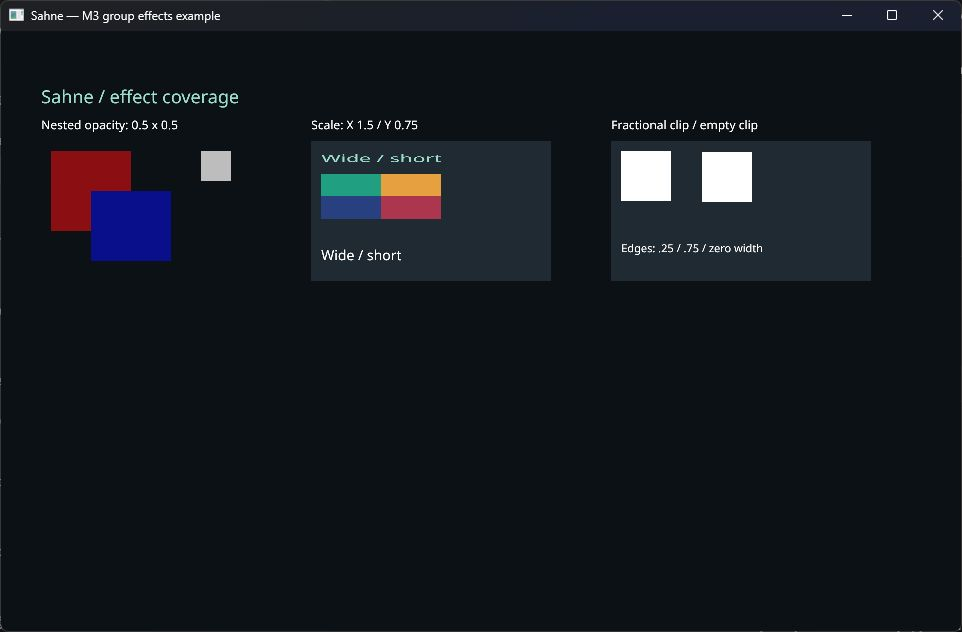

# M3 additional effect fixture and local visual evidence

Updated: November 25, 2026. Status: original source fixture, independent scene/asset checks and CPU references, plus local Windows D3D12 visual/resize evidence for `groups-effects`. The nested-opacity, nonuniform-scale and empty-clip cases agree visually with the specified fixture. Exact fractional GPU pixel/color agreement remains unverified; the scaled JPEG reference does not provide that measurement. Existing [group-preview evidence](m3-group-preview.md) remains scoped to its earlier fixture. Full G3 is not complete.

## Scope and entry point

examples/group-effects is a separate original source package. It preserves all previous examples and reuses an unchanged copy of the project's 8x8 RGBA quadrant PNG; there is no third-party sample media or script. Its three regions share a 1920x1080 canvas and the existing compiler/renderer policy. `groups` still selects examples/group-preview, while the new literal `groups-effects` selects this package. Neither accepts a path/URL, arbitrary input or new permission.

Nonvisual validation:

```powershell
cargo test -p wallpaper-preview --locked
```

The following opens the original effect fixture in a window:

```powershell
cargo run --release -p wallpaper-preview --locked -- --example groups-effects --seconds 10
```

The existing resize/lifecycle/device-loss code is shared. The user authorized the local checks recorded below after the earlier screen-access checkpoint. The mode does not expand accepted CSS or change rendering algorithms, limits, blending, shaders or sandbox policy. Desktop attachment, additional DPI/driver/GPU targets and quantitative fractional GPU comparison remain unverified.

## Case A: nested opacity and inner clipping

The outer group is at `(80,160)`, 400x280, opacity 0.5, with a transparent background and clipping. Its inner group begins at local `(20,20)`, is 300x220 and has another opacity 0.5. Two opaque red/blue 160x160 children overlap; blue is later in source order. Blue extends 20 pixels below the inner clip. A separate opaque white 60x60 badge at outer-local `(320,20)` belongs only to the outer opacity boundary.

For linear-light premultiplied source-over, the overlap must show 0.25 blue plus 0.75 canvas background, with no red contribution. Red-only content likewise contributes 0.25 red. The white badge contributes 0.5 white, distinguishing one opacity boundary from two. Blue outside the inner clip must disappear even while still inside the outer group's rectangle. These equations are CPU reference expectations, not GPU pixel measurements.

| Canvas pixel-center sample | Expected linear RGB, where B is the canvas background |
| --- | --- |
| `(190.5,270.5)` | `0.75 B + (0,0,0.25)` |
| `(110.5,190.5)` | `0.75 B + (0.25,0,0)` |
| `(410.5,190.5)` | `0.5 B + (0.5,0.5,0.5)` |
| `(190.5,410.5)` | B; outside the inner clip |

The CPU plan requires target 2 to composite into target 1, then target 1 into root target 0, each at opacity 0.5. Paint order is retained, rather than replacing the two groups with leaf alpha.

## Case B: nonuniform text and image scale

The middle panel starts at `(620,160)`. Its child at local `(20,20)` scales X by 1.5 and Y by 0.75, with explicit top-left origin. The same `Wide / short` text also appears untransformed below as a control, using the same authored 28 px font. The transformed and control text differ in color to identify them; color equivalence is not the comparison.

| Output | Required canvas rectangle |
| --- | --- |
| Transformed text | `(640,180)`, 270x30 |
| Transformed PNG | `(640,225)`, 240x90 |
| Untransformed text control | `(640,370)`, 400x40 |

The transformed text raster is 270x60 at raster scale 1.5, mapped to the 270x30 world quad; the control raster is 400x40 at scale 1. The PNG keeps all 256 original decoded bytes, including straight half-alpha pixels. The CPU tests check these dimensions/bytes and independent v2 asset matching. The local window reference below additionally observes stretched glyphs, all seven text surfaces and image compositing in this original fixture; it does not establish arbitrary text/font coverage.

## Case C: fractional clips and empty clipping

The right panel begins at `(1220,160)`. Two transparent 100x100 clip groups contain white 140x140 fills starting at local `(-10,-10)`, so every edge must be clipped. Their canvas clips are `(1240.25,180.25,100,100)` and `(1400.75,180.75,100,100)`. Both coarse scissors span 101x101 integer pixels; exact fragment pixel-center checks must distinguish the fractional boundaries.

| Pixel-center sample | Expected result |
| --- | --- |
| `(1240.5,181.5)` / `(1400.5,181.5)` | White / panel background |
| `(1340.5,200.5)` / `(1500.5,200.5)` | Panel background / white |
| `(1250.5,180.5)` / `(1410.5,180.5)` | White / panel background |
| `(1250.5,280.5)` / `(1410.5,280.5)` | Panel background / white |

A third group has zero width; its oversized white child must produce no paint operation and leave the panel unchanged. Its sample `(1560.5,200.5)` remains panel background. Empty clipping does not skip source validation or weaken admission limits.

These are exact native-canvas CPU reference checks. A scaled window or JPEG screenshot cannot establish exact GPU pixel/color agreement; retain that distinction when recording the future visual result. No GPU readback/golden comparison is implemented by this step.

## Budgets, validation and next checkpoint

The source produces 44 layers and 66 group/draw commands. Its CPU plan has three canvas targets, 22 paint/composite operations, seven text rasters and 25,643,936 known texture bytes. The zero-width clip is culled; all existing source, image, hierarchy, text-surface, uniform and device limits remain. Texture bytes exclude the same driver/font/cache/baseline costs documented in the [renderer contract](m3-group-preview.md).

Three added tests independently compile/decode the fixture and validate immutable images, then check nested source-over samples/order, nonuniform text/image/control geometry and fractional/empty clip samples. They use the CPU reference evaluator and create no device/window. They do not certify GPU results. No external dependency, feature/version, license or Cargo.lock change is introduced; existing dependency advisories and production-helper requirements remain unchanged.

Primary references consulted November 24, 2026: [W3C compositing groups](https://www.w3.org/TR/compositing-1/#groupcompositing) and [wgpu 30.0.1 scissors](https://docs.rs/wgpu/30.0.1/wgpu/struct.RenderPass.html#method.set_scissor_rect), alongside the existing native transform/clip and renderer contracts. The implementation still uses the project's deliberately restricted semantics, not browser conformance.

The authorized local observation/reference and maximize/restore checks are recorded below, along with controlled lifecycle results. Fractional-pixel GPU accuracy remains unverified until a suitable quantitative GPU comparison is performed. Broader G3 acceptance, native animation/pause, hashes/I1 and production integration remain open.

## Local nonvisual evidence — November 24, 2026

All 109 workspace Rust tests passed, including the preview's sixteen tests and the three added effect-fixture checks. Workspace release build, Clippy with warnings denied and formatting passed. Base revision during validation: 7406452 with this continuation uncommitted. The original compiler/preview fixtures remain separate; no previously recorded visual reference was overwritten. Existing Cargo cache hardlink/copy notices remain.

Cargo.lock/external dependencies and native sandbox policy/code were unchanged; the native corpus was not repeated for that fixture/selection-only continuation. At that initial checkpoint, no window, adapter/device, screen capture or UI interaction had occurred. Hosted CI, non-Windows builds and the fixture's GPU/window/visual/lifecycle checks had not run. Work paused at the user's screen-access checkpoint, before the separately authorized observations below. CPU samples alone do not satisfy G3 visual acceptance.

## Authorized visual reference — November 25, 2026

Release source 9005152, NVIDIA GeForce RTX 3050 Laptop GPU, driver 32.0.16.1062, D3D12, scale 1. This run reported two active 1920x1080 displays at 120 Hz, at desktop positions `(-1920,0)` and `(0,0)`. The window checks did not exercise hotplug, mixed DPI or movement between displays; the topology observation alone does not close that matrix.



This is an unchanged actual-window JPEG, including chrome. Nested red/blue content is visibly dimmer than the one-level white badge; later blue occludes red without an extra red mixture, and its bottom ends at the inner clip. This agrees visually with the two opacity boundaries and their CPU reference, without measuring an exact linear color value from the image.

The middle region shows visibly wider/shorter transformed text above the normal control, and the PNG in its authored nonuniform world rectangle. All seven text surfaces/labels appeared without missing glyphs, atlas corruption or unintended clipping in this original case. The right region shows the two bounded white fills and no third fill in the zero-width clip area. Scaled appearance agrees with the intended layout/empty clipping; it does not prove the `.25` versus `.75` GPU sample decisions numerically.

Maximizing changed the client from 960x600 to 1920x1009; the fixed-canvas fit, three regions and text/image appearance remained consistent. Restoring returned to the same 960x600 result. Escape exited 0 after three presentations, one generation and zero pending recreations. Initialization logged 44 layers, 66 commands, three canvas targets, seven text surfaces and 25,643,936 known texture bytes, with no initialization/rendering error in the log. Logs: ignored target/m3-effects-visual/737cac5f34ab4c379d8547e89ac634e7/.

## Controlled lifecycle checks — November 25, 2026

Seven sequential owned processes passed under a 25-second outer deadline each. Report: ignored target/m3-effects-lifecycle/55f61643afe24c09a503f111851cb475/summary.json, source 9005152, with exact binary SHA256 and per-case arguments/results. All cases exited 0 with zero pending recreations. These timed cases used no UI automation.

| Case | Duration | Frames | Generations | Evidence |
| --- | --- | --- | --- | --- |
| Effects quiet idle | 6 s | 1 | 1 | No continuous redraw |
| Effects recreate twice | 8 s | 3 | 3 | Full fixture rebuilt per generation |
| Effects device loss | 8 s | 2 | 2 | Requested-generation callback seen, restored frame confirmed |
| Original groups idle | 4 s | 1 | 1 | Existing fixture still initializes/draws |
| Static idle | 4 s | 1 | 1 | Existing v1 path |
| Image idle | 4 s | 1 | 1 | Existing v1 image path |
| M1 baseline | 4 s | 1 | 1 | Original renderer path |

The device-loss result still requires the actual callback and a later-generation frame, not any redraw. This is requested device destruction, not forced driver/hardware failure. Old-mode checks here are timed runtime regressions, not new screenshot or recreation/loss evidence for those modes. The short idle observation is not a long-duration performance/soak result. The subsequent source change only removes the stale pending-validation help sentence; algorithms, shaders, limits and dependencies are unchanged. The release preview was rebuilt and help checked afterward. Quantitative GPU clip/color comparison, additional configurations and full G3 remain open.
