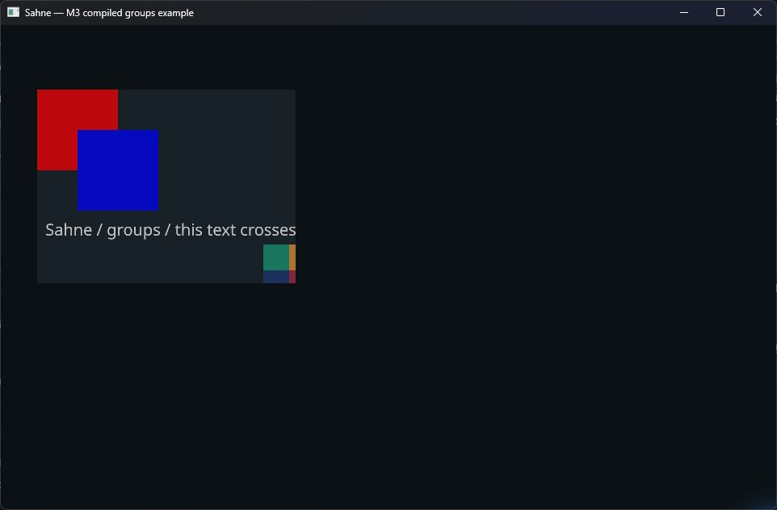

# M3 fixed group renderer and local validation

Updated: November 24, 2026. Status: the original version-2 group fixture passed local Windows D3D12 initialization, visual clipping/opacity/resize checks and controlled lifecycle tests; old static/image modes also passed regression checks. Evidence below is limited to this original fixture and recorded hardware. M3/G3 remain incomplete; arbitrary content, broader effect fixtures and platform/display coverage remain open.

## Entry point and authorization checkpoint

The new literal `groups` example selects only the original embedded examples/group-preview source package. It compiles through `compile_groups`, independently decodes the scene and validates immutable image assets before planning GPU resources. There is no external path, shader input, script execution or new permission. Existing default M1, `--example static` and `--example image` retain their previous paths.

The original examples/static-groups compiler fixture remains unchanged. The separate preview keeps its overlapping red/blue shapes but extends a long text box beyond the parent's right edge and moves the PNG beyond its right/bottom edges. The text world rectangle reaches x=950 while the parent clip ends at x=730; the PNG spans `(650,484)` through `(778,612)` against parent clip `(90,100)` through `(730,580)`. These cases make actual clipping observable rather than merely setting a clip flag on content that already fits. Its checker.png is an unchanged copy of the project's original quadrant pattern. The CLI compile-groups check still selects the original compiler fixture; preview CPU tests independently check this additional source package and its assets.

Nonvisual checks:

```powershell
cargo test -p wallpaper-preview --locked
cargo run --release -p wallpaper-cli --locked -- --compile-groups-check
```

The following command opens the original fixture in a window:

```powershell
cargo run --release -p wallpaper-preview --locked -- --example groups --seconds 10
```

The existing recreation and device-loss flags have now been exercised in group mode on the recorded machine. `--desktop` combinations remain unverified. The implementation originally paused before window/screen access at the user's request; the user subsequently authorized the checks recorded below. No alternate screen-access mechanism was used to bypass that pause.

## Ordered rendering and opacity

A CPU-only planner consumes the validated BeginGroup/Draw/EndGroup sequence. The root paints into a fixed canvas-sized RGBA8 sRGB texture. Groups with opacity other than one receive individual full-canvas transparent targets, including zero-opacity and sequential groups, consistent with the [v2 admission contract](m3-groups.md). Opaque groups preserve command/clip order without allocating a redundant intermediate. Targets are unique for the scene; no pass samples its own destination.

Children paint in source order into the current opacity target. At group end, the child's texture is sampled and its already-premultiplied linear RGB and alpha are both multiplied by that group's opacity, then source-over composited once into the parent with premultiplied blending. Rectangle colors and source PNG textures use straight-alpha blending when first painted into an intermediate. Nested group composites close from the inside out; leaf alpha is never multiplied by cumulative parent opacity. The fixed WGSL shader uses explicit mip-zero sampling, not source-provided instructions.

The root clear color is converted from straight sRGB to premultiplied linear values. The final root texture is copied with replacement blending into an aspect-preserving, centered quad in the physical client area, avoiding a second blend over its own background. Letterbox regions use the scene background. All intermediate painting uses native canvas resolution; resizing updates only the final quad. Nearest/clamped sampling is explicit throughout. Large presentation magnification can expose the fixed canvas raster; high-DPI quality equivalence with the v1 direct text path is not claimed.

The initial implementation opens a load-preserving render pass per paint/composite operation, with separate clears and presentation. The fixture plans six paint/composite operations, two canvas targets and one text surface: ten passes on its first frame including text preparation, nine on later redraws. This favors inspectable order over batching and is not a performance claim. The existing change-driven event loop introduces no per-frame animation timer; the controlled quiet-idle check below observed one presentation in six seconds.

## Bounds, clipping and text

Validated accumulated transforms determine rectangle/image world-space quads. Every operation receives its effective canvas/ancestor clip. A conservative integer scissor encloses that clip, while the fragment shader rejects pixel centers outside the exact fractional rectangle. Empty/outside clips and zero-area draws are skipped; their source data and resource declarations have already been validated. This is hard axis-aligned clipping, not rounded/path clipping or edge anti-aliasing.

Glyphon's scalar text-area scale cannot directly express distinct X/Y scales. Each visible text node therefore gets a separate transparent, tightly bounded raster target. Text is shaped with the existing bundled Noto Sans, no wrap and 1.25 line height; raster scale is the larger accumulated axis scale, with a minimum of one. Its premultiplied texture is then mapped to the independently transformed world rectangle, preserving anisotropic scale and source paint order. UV extent accounts for ceil-rounded raster dimensions, and the world quad/ancestor clip bounds the final result. The fixed uniform-scale case is observed below; a later [effect fixture](m3-effect-fixtures.md) adds a limited stretched-text window reference. Exact fractional GPU sample agreement remains open.

Text preparation/raster painting is cached after the first successful command encoding; later window resizes reuse the fixed scene/text textures. A new renderer/device generation rebuilds everything, including this cache. Group mode owns an RGBA8-target Glyphon atlas/viewports rather than reusing the differently formatted swapchain text pipeline. Text shaping, atlas allocation and driver failures still require runtime checks; cached text is not a native animation implementation.

## Admission limits before allocation

The planner first checks every declared image and the canvas against device texture dimensions, then accounts for all root, opacity, image and text textures. Existing source/scene/media/node/depth/opacity-intermediate limits are retained. Additional renderer policy:

| Resource | Bound |
| --- | --- |
| Known texture storage combined | At most 256 MiB, using checked width × height × 4 byte accounting |
| Text raster targets | At most 128 visible text nodes and 64 MiB total |
| One text raster dimension | At most 4,096 and the device limit |
| Rasterized font size | At most 512 px after raster scale |
| Uniform record | 80 bytes, stride rounded to the device's required dynamic-offset alignment |
| Uniform allocation/offsets | Checked against max buffer size and u32 offset range |

All applicable limits must pass; a scene accepted by the data codec may still be rejected by this renderer admission policy. Values are not silently clamped or downscaled to evade budgets. Text rectangles are conservatively budgeted before ancestor cropping. Even invisible opacity groups reserve targets. The preview fixture's known texture bytes are 16,804,096: two 8,294,400-byte canvas targets, one 215,040-byte text raster (840x64) and the original 256-byte image. The unchanged compiler fixture's CPU plan separately remains 16,691,456 bytes with its smaller text box.

The texture estimate excludes driver padding/staging, Glyphon atlases, shaping/cache/vertex buffers and existing baseline preview allocations; it is not a total RAM/VRAM measurement or OS limit. Those costs and allocation failures remain material runtime/performance questions before arbitrary content. Initialization uses wgpu validation/OOM error-scope guards, popped in reverse order before awaiting results, then propagates captured errors through the existing bounded initialization recovery path. No adapter limits or sandbox policies are raised. Normal initialization and requested device-loss recovery passed below; deliberate OOM/validation-error injection was not performed.

## CPU checks and remaining acceptance

Eight new tests cover the original resource/pass plan, independent one-pixel rectangle/group source-over results, nested order/no self-sampling, zero-opacity and opaque-group behavior, exact fractional clip uniform values/coarse scissors, letterboxing, anisotropic text raster sizing, text/count/font/device/combined texture rejection and Naga parsing/validation of all shader entry points. The additional preview fixture is independently compiled/decoded/asset-checked, and text/PNG overflow against the parent clip is required. These tests use no device or window. The overlap reference distinguishes one group-opacity composite from separate per-child alpha, but it does not validate the GPU pipeline or captured pixels.

No new dependency, feature, license, native API binding or Cargo.lock change is needed. Existing renderer/font advisories and source/asset isolation uncertainty remain in their prior reviews. This fixed trusted preview does not authorize untrusted source/media/font processing in the host; production helper/G2 integration remains M4 work.

Primary documentation consulted November 24, 2026: [wgpu 30.0.1 blend states](https://docs.rs/wgpu/30.0.1/wgpu/struct.BlendState.html), [scissor rectangles](https://docs.rs/wgpu/30.0.1/wgpu/struct.RenderPass.html#method.set_scissor_rect), [sRGB formats](https://docs.rs/wgpu/30.0.1/wgpu/enum.TextureFormat.html), [error-scope guard lifecycle](https://docs.rs/wgpu/30.0.1/wgpu/struct.ErrorScopeGuard.html) and [Glyphon 0.12.0 preparation/rendering](https://docs.rs/glyphon/0.12.0/glyphon/struct.TextRenderer.html). Pinned Glyphon cache/atlas source confirms straight-alpha blending and accurate color conversion for the local raster target. These API/source checks are not GPU runtime evidence.

The authorized local window/reference, resize, quiet-idle, recreation/device-loss and old-mode regression checks are recorded below. The later [additional effect record](m3-effect-fixtures.md) adds nested-opacity/nonuniform-scale/empty-clip window observations. Exact fractional GPU sample/color comparison, broader display/DPI/hardware coverage, production input, animation/timing, hashes/I1 and full G3 remain open. CPU references and scaled screenshots must not be treated as quantitative GPU pixel acceptance.

## Authorized window reference — November 24, 2026

Release source e00a31d, NVIDIA GeForce RTX 3050 Laptop GPU, driver 32.0.16.1062, D3D12, scale 1. This run reported one active 1920x1080 display at 120 Hz. The user explicitly authorized visual testing after the earlier checkpoint.



This is the unchanged actual-window JPEG, including chrome, not a pixel-exact/colorimetric golden. In a 960x600 client area, the panel occupies `(45,80)` through `(365,320)`. Opaque blue correctly occludes red within the half-opacity group: the overlap has no extra red mixture relative to the rest of the blue rectangle. Panel, child geometry and color appearance agree visually with the source/CPU reference and one composite at group end.

The long text is cut at client x=365, the panel edge. The PNG starts at `(325,272)` and is clipped to 40x48 visible client pixels, retaining visible portions of the original quadrants including the half-alpha lower-right region. Content does not leak beyond the right/bottom panel edges. This observes the fixture's uniform scale and integer-edge clipping, not every transform or fractional clip case.

Maximize changed the client to 1920x1009; the fitted canvas, overlap, text and PNG clipping remained visually consistent. Restore returned to the same 960x600 output. Escape exited 0 after three presented frames/one generation, with zero pending recreations. GPU initialization reported two canvas targets, one text surface and 16,804,096 known texture bytes, with no initialization/rendering error in the log. Log root: ignored target/m3-group-visual/85cdfc1f98844d739d6e19ef49447ede/.

The existing static and PNG windows were separately observed against their previous references and closed normally with Escape: each exited 0 with one presentation/one generation. Logs: target/m3-group-regression/static-c73505cd278340189e725cd402d25f84/ and target/m3-group-regression/image-fd917d9061404648a3a5cb15e8732889/. These are limited visual regressions; they do not establish desktop attachment or additional hardware support.

## Local nonvisual validation — November 24, 2026

All 106 workspace Rust tests passed, including the preview's thirteen tests (eight new group tests). Workspace release build, Clippy with warnings denied and formatting passed. Exact independent CPU overlap/compositing results and shader validation are recorded by those tests; they do not execute any GPU pipeline. Base revision during checks: 99814e4 with this continuation uncommitted. Existing Cargo incremental-cache hardlink/copy notices remain.

Cargo.lock and external dependencies were unchanged. Native sandbox code/policy/corpus were unchanged and its full suite was not repeated for that preview-only continuation. At this initial checkpoint, hosted CI, non-Windows builds, actual group GPU/device/window/visual checks and existing-mode runtime regressions had not run. Work paused at the user's screen-access checkpoint; the subsequently authorized local evidence is recorded in the window and lifecycle sections. Full G3 remains open.

## Controlled lifecycle regression — November 24, 2026

Ten sequential owned processes passed with a 25-second outer guard and bounded logs. Report: ignored target/m3-group-lifecycle/5f4b67a8035441788db78c7d53521c8e/summary.json, committed source e00a31d, retaining the tested binary SHA256 and per-case arguments/results. Each process exited 0 with zero pending recreations. No UI automation occurred during these timed cases.

| Case | Duration | Frames | Generations | Additional requirement |
| --- | --- | --- | --- | --- |
| Groups idle | 6 s | 1 | 1 | No continuous redraw |
| Groups recreate twice | 8 s | 3 | 3 | Fresh renderer per generation |
| Groups device loss | 8 s | 2 | 2 | Requested-generation callback and restored frame confirmed |
| Static idle | 6 s | 1 | 1 | No continuous redraw |
| Static recreate twice | 8 s | 3 | 3 | Recovery regression |
| Static device loss | 8 s | 2 | 2 | Callback and restored frame confirmed |
| Image idle | 6 s | 1 | 1 | No continuous redraw |
| Image recreate twice | 8 s | 3 | 3 | Recovery regression |
| Image device loss | 8 s | 2 | 2 | Callback and restored frame confirmed |
| Original M1 baseline | 4 s | 1 | 1 | Existing path remains functional |

Device-loss acceptance still requires the actual requested-generation callback before a later-generation frame; unrelated redraws do not satisfy it. This is application-requested device destruction, not a forced driver/hardware fault. Quiet-idle observations are six seconds per compiled mode, not a long-duration performance/soak claim. Subsequent code edits only remove stale pending-validation help/log text and update a module comment; rendering algorithms, limits and dependencies are unchanged. The release preview was rebuilt and its nonvisual help checked afterward. Full G3 and the broader effect/platform cases above remain open.
