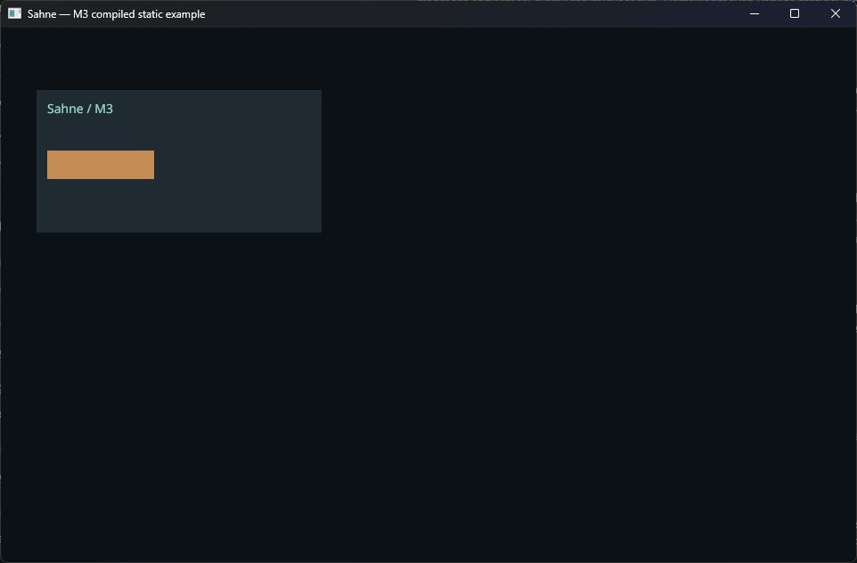

# M3 compiled static preview

Date: November 14, 2026. Status: original embedded HTML/CSS rendered in a local Windows D3D12 window. M3/G3 remain incomplete.

## Run

```powershell
cargo run --release -p wallpaper-preview --locked -- --example static --seconds 30
```

Escape closes window mode. Only the literal example name `static` is accepted; a path, URL, unknown example or missing example value fails. The existing default M1 fixture remains available without `--example`. The CLI's `--compile-check` remains a nonvisual check.

The new mode embeds examples/static-scene at build time, validates the in-memory package, compiles the restricted HTML/CSS and independently decodes/validates its scene before allocating drawing resources. It opens no source path and executes no JS. The current example has a panel, title and accent rectangle; images/media and arbitrary package loading remain disabled.

## Rendering behavior

The fixed 1920x1080 canvas is uniformly scaled to fit the physical client area and centered; resizing does not reflow CSS or change authored pixel values. Surface/background color covers the letterbox area. At 960x600, scale is 0.5 with a 30-pixel vertical offset. The panel is 320x160 at (40,70), the title box starts at (52,82), and the accent rectangle is 120x32 at (52,138), all relative to the client area. Glyph ink has its normal font baseline inside its text box.

Rectangles use a bounded, aligned uniform record per node and an original WGSL quad shader. An sRGB surface is required; straight sRGB color bytes are converted to linear RGB for output, with straight-alpha blending. Text uses the existing bundled Noto Sans/Glyphon path. Each text item retains its own prepared renderer so rectangle/text commands can stay interleaved in scene order instead of rendering all text above every later rectangle.

Text has line height 1.25 times font size, no automatic wrapping and clipping to its own fixed box. Literal LF creates another shaped line. Parent boxes currently have visible overflow; this is not ancestor clipping or group compositing. The code adds no supported opacity/transform/animation source property and does not fake group opacity by changing every child alpha.

Drawing uses the existing change/recovery-driven event loop; it introduces no animation timer. The initial interactive run is not a quiet-idle benchmark. Compiled-mode quiet-idle, automated resize/reference comparisons, explicit recreation/device-loss regressions, additional DPI/hardware, desktop attachment and broader text/stacking fixtures remain follow-up validation. Existing M1 evidence must not be read as proof that those new-mode combinations have passed.

## Observed local reference



This is an unchanged JPEG capture of the actual preview window, observed with Computer Use and retained as a visual reference, not a pixel-exact golden image. Window chrome is included. Panel/title/accent geometry, colors and text matched the original source fixture at the captured size. It is a limited reference, not full G3 acceptance.

Observed environment: Windows 11 build 26200, NVIDIA GeForce RTX 3050 Laptop GPU, driver 32.0.16.1062, D3D12, 100% scaling; two 1920x1080 displays. The owned 120-second process exited zero with generation 1 and no pending recreations. Retained logs: ignored `target/m3-preview-runs/c56833e7ea894e848cfe98638f203ccc/`. During the interactive session the app received 123 surface-size/scale notifications and presented 265 frames; do not interpret that as a stationary idle measurement or attribute every event to a specific actor.

Two new pure checks cover canvas aspect/letterbox geometry and sRGB/alpha conversion; all 65 workspace Rust tests passed, including the preview's four tests. Preview Clippy, release build, formatting and local documentation links passed. Help and unknown-example rejection passed without opening a window. The new mode was visually exercised, but its explicit recreation/device-loss flags were not run during this phase. No user testing is requested for checks the agent can perform when work resumes.

No external package version or feature changes in this continuation: the preview now links the already reviewed local compiler/scene crates and their existing JSON graph. Existing renderer/font dependency risks and source/asset isolation requirements remain unchanged. The shader is fixed project code, not a source-package shader feature. Arbitrary source, fonts, images and GPU instructions remain unavailable.

Primary documentation consulted November 14, 2026: [wgpu 30.0.1 bind group layout](https://docs.rs/wgpu/30.0.1/wgpu/struct.BindGroupLayoutEntry.html), [Glyphon 0.12.0 text preparation/rendering](https://docs.rs/glyphon/0.12.0/glyphon/struct.TextRenderer.html) and [WGSL uniform rules](https://www.w3.org/TR/WGSL/). Existing cached Cosmic Text source confirmed the pinned buffer wrap/size and RGBA APIs. Only local Windows runtime behavior is claimed.

## Resume point

Finish quiet-idle and compiled-mode lifecycle checks, then extend M3 with validated image resources, stacking/clipping/transforms/group opacity, native animation/pause semantics and compiled provenance/hashes. Keep I1 metadata/resource/callback mappings and full G3 evidence explicit. The current flat compiler still rejects unsupported effects/media rather than silently producing an approximation.
